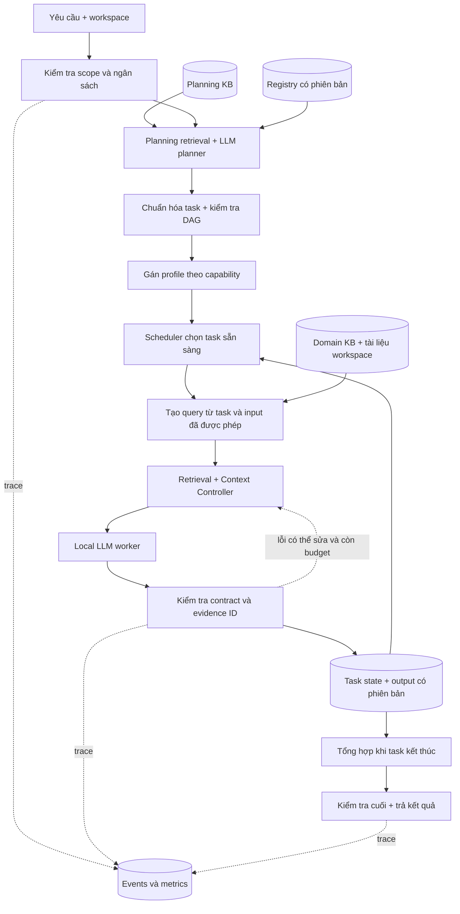

# KẾ HOẠCH NGHIÊN CỨU VÀ TRIỂN KHAI CAPSTONE 1

**Đề tài đề xuất:** Phân rã yêu cầu có hỗ trợ truy xuất và phân bổ ngữ cảnh có xét chồng chéo cho hệ thống Multi-Agent RAG chạy cục bộ.

**English:** Retrieval-Guided Task Decomposition and Overlap-Aware Context Allocation for Resource-Constrained Local Multi-Agent RAG.

**Phiên bản:** 1.1 — ngày 05/09/2026 — **[CẬP NHẬT v1.1: incremental delivery]**. **Đối tượng:** nhóm 5 sinh viên năm 4, thời gian 12 tuần. **Trạng thái:** thiết kế đề xuất để triển khai và kiểm chứng; chưa phải báo cáo kết quả thực nghiệm.

> **[THÊM v1.1 — phạm vi thay đổi]** Bổ sung mục 19 **“MVP and Incremental Delivery Strategy”**; đồng bộ mục 12.2 (timeline), ghi chú ticket tại 12.3, gates tại 13.2 và scope-cut ladder tại 14. Các mô tả kiến trúc, RQ, thuật toán P/N/O, A/B/C, ablation, benchmark, công thức metrics và nguồn nghiên cứu vẫn giữ nguyên. Mục 19 quy định thứ tự bàn giao; mức lite không thay thế đặc tả full. Các dấu `[THÊM v1.1]` / `[CẬP NHẬT v1.1]` chỉ rõ đoạn mới hoặc thay thế.

> **[THÊM v1.1 — đối chiếu Shared Chat]** Đã đọc đến cuối nội dung đang hiển thị của [snapshot cập nhật](https://chatgpt.com/share/6a9b8860-4274-83ec-9c91-8067564a80c0). Sau bản plan, snapshot có các trao đổi về cập nhật link; chưa hiển thị nội dung thảo luận MVP chi tiết. Các yêu cầu M0–M3 được lấy trực tiếp từ chỉ dẫn cập nhật của người dùng trong tác vụ hiện tại, không suy diễn từ phần hội thoại chưa thấy.

Tài liệu dựa trên phần kế hoạch và phản biện cuối trong [cuộc hội thoại được cung cấp](https://chatgpt.com/share/6a9b7d41-dda4-83ec-8d4a-3a043baac9cf), đối chiếu trực tiếp các nguồn nghiên cứu và tài liệu kỹ thuật. Những tệp đính kèm cũ không có nội dung đọc được trong bản chia sẻ nên không được xem là đã thẩm định. Tài liệu này không xác nhận trạng thái code hiện hành và không thay thế giao thức Pilot cũ bằng một tuyên bố ngầm: đây là hướng nghiên cứu mới, cần mã phiên bản benchmark riêng.

## 1. Quyết định chính và các chỉnh sửa đối với plan cũ

**Nên triển khai, với hai cơ chế nghiên cứu chính:** (P) retrieval hỗ trợ LLM phân rã yêu cầu; (O) phân bổ evidence có kiểm soát trùng lặp, liên quan và ngân sách token. Chuẩn hóa task (N) là cơ chế hỗ trợ có ablation riêng. Agent Registry, DAG, kiểm tra output, tracing và UI là hạ tầng phục vụ kiểm chứng.

Không đặt mục tiêu “hệ thống luôn tốt hơn”, “tự học hoàn toàn”, hoặc “đạt chuẩn Microsoft”. Microsoft cung cấp kiến trúc tham khảo dựa trên kinh nghiệm triển khai; đó không phải chứng nhận chất lượng hay bằng chứng thực nghiệm cho hệ thống của nhóm. [Microsoft — giới thiệu kiến trúc](https://microsoft.github.io/multi-agent-reference-architecture/).

| Điểm trong kế hoạch trước | Quyết định hoàn thiện | Lý do và hệ quả |
|---|---|---|
| Understanding RAG nghe như tự phân rã | Đổi thành Retrieval-Guided Task Decomposition | Retriever tìm tài liệu hỗ trợ; LLM sinh task; code kiểm tra cấu trúc |
| Xem retrieval trước decomposition là ý tưởng riêng | Không tuyên bố mới ở cấp nguyên lý | RaDA đã có retrieval-augmented task decomposition; phải so sánh related work |
| DAG thích ứng được mô tả gần HERA | Gọi đúng là DAG sinh theo yêu cầu, có giới hạn | Không có quá trình tiến hóa topology trong core |
| Càng ít context overlap càng tốt | Chỉ giảm phần dư thừa không phục vụ nhiệm vụ | Một evidence có thể cần cho nhiều task; cắt nhầm làm mất grounding |
| Đưa evidence vào shared memory sẽ giảm token | Tách tiết kiệm lưu trữ với token inference | Mỗi lần đưa nội dung vào một prompt vẫn phải tính token; ID riêng không truyền kiến thức |
| Authentication, authorization, JWT gần nghĩa nên gộp | Không gộp theo cosine đơn thuần | Cùng domain không có nghĩa cùng nghĩa vụ; phải bảo toàn yêu cầu nguyên tử |
| Verifier trả PASS là câu trả lời đúng | Tách schema/citation validity và semantic correctness | Code không chứng minh nội dung được nguồn hỗ trợ; cần đánh giá độc lập |
| A/B/C tốt hơn là chứng minh từng thuật toán | Giữ A/B/C và thêm ablation có kiểm soát | C thay đổi nhiều cơ chế cùng lúc nên cần tách nguyên nhân |
| Một laptop thực thi parallel sẽ nhanh hơn | Mặc định một lần generation tại một thời điểm | DAG có nhánh độc lập nhưng tốc độ thực tế còn phụ thuộc runtime/phần cứng |
| Dataset có một gold DAG duy nhất | Gold theo nghĩa vụ, evidence và dependency bắt buộc | Nhiều cách chia/gộp task khác nhau vẫn hợp lệ |

### 1.1. Phạm vi bắt buộc và ngoài phạm vi

**Core bắt buộc:** một web chat local; nhập tài liệu văn bản; corpus được định phiên bản; một local LLM đóng băng; Planning KB; Domain KB; 3 profile domain; planner JSON; normalizer; registry; task retrieval; context controller; DAG scheduler; output có nguồn; trạng thái thiếu thông tin; tracing; A/B/C; ablation; benchmark và báo cáo.

> **[THÊM v1.1]** Danh sách trên là đích **M2 — Core Complete**. M0 và M1 là các bản bàn giao end-to-end được nghiệm thu riêng theo mục 19; không cần hoàn tất mọi module full mới được demo, nhưng không gọi bản lite là M2.

**Ngoài critical path:** Experience Library tự cập nhật, HERA-style prompt evolution, QLoRA/fine-tuning, tự sinh agent không giới hạn, debate nhiều vòng, microservices, Kubernetes, triển khai public, paid API, OCR phức tạp, audio/video, tự sửa hoặc thực thi code tải lên.

Không cần tạo một agent cho mỗi thuật toán. Retrieval, token counting, filter, dedup, scheduler và logging chủ yếu là code thường. Core chỉ cần các lần gọi LLM có nhiệm vụ rõ: planner, worker theo profile, synthesizer; normalizer chỉ gọi bổ sung trong trường hợp mơ hồ.

## 2. Bài toán, người dùng và câu hỏi nghiên cứu

### 2.1. Bài toán thực tế được chọn

Người dùng là sinh viên hoặc thành viên nhóm phần mềm muốn hỏi/review tài liệu của một dự án theo nhiều khía cạnh: bảo mật đăng nhập/phân quyền, dữ liệu/truy vấn, API/kiến trúc. Input có thể dài, lặp ý, thiếu thuật ngữ chuẩn hoặc yêu cầu nhiều đầu ra cùng lúc.

Hệ thống cần biến yêu cầu thành các nghĩa vụ rõ ràng, tìm evidence tương ứng, tạo nhận định có nguồn và nêu phần chưa đủ dữ liệu. Ví dụ “hãy review authentication, quyền đọc dữ liệu, query danh sách và API contract; chỉ ra vấn đề và thứ tự sửa” phải được trả lời đủ từng ý, không sinh thêm một báo cáo security chung nhưng bỏ qua quyền đọc dữ liệu.

**Giới hạn sử dụng:** review dựa trên bộ tài liệu/đoạn code được cung cấp; không coi đây là kiểm thử penetration test, thực thi truy vấn thật hay kiểm chứng toàn bộ codebase. Không suy ra lỗi production từ việc thiếu một mục trong tài liệu; diễn đạt “chưa thấy bằng chứng trong tài liệu” khi phù hợp.

### 2.2. Giả thuyết có thể bác bỏ

| Mã | Câu hỏi | Giả thuyết | Bằng chứng cần |
|---|---|---|---|
| RQ1 | Planning retrieval có giúp phân rã đầy đủ hơn không? | P tăng coverage yêu cầu, nhất là câu nhiều thuật ngữ hoặc diễn đạt lộn xộn | So sánh P bật/tắt với các thành phần còn lại cố định |
| RQ2 | O có giảm token dư thừa mà duy trì chất lượng không? | O giảm tổng token input và phần context thừa; chất lượng không giảm quá biên định trước | So sánh O bật/tắt, có khoảng tin cậy và kiểm tra evidence bị cắt |
| RQ3 | Pipeline hoàn chỉnh có đáng dùng trên máy local không? | C tạo trade-off chất lượng/tài nguyên tốt hơn trong một số nhóm case | A/B/C cùng cấu hình; failure, latency, RAM và token đều được báo cáo |

RQ1 và RQ2 là chính; RQ3 là kết luận hệ thống, không thay thế thí nghiệm tách cơ chế. Không khẳng định chuỗi “decomposition tốt → retrieval tốt → answer tốt” là quan hệ nhân quả đã được chứng minh chỉ từ tương quan các metric.

**Đóng góp có thể bảo vệ:** một thiết kế kết hợp được mô tả đủ để tái lập; thuật toán chọn task/context có giới hạn và kiểm chứng; một benchmark yêu cầu đa khía cạnh có annotation minh bạch; dữ liệu thực nghiệm về lợi ích và điều kiện thất bại trên cấu hình local xác định. Tính mới mạnh hơn cần khảo sát rộng và đánh giá với các hệ công bố, không tự suy ra từ việc ghép hai nguồn.

## 3. Cơ sở nghiên cứu và cách áp dụng

### 3.1. Những nguồn gần nhất cần đọc trước

| Nguồn | Nội dung liên quan | Áp dụng vào đề tài | Giới hạn khi suy luận |
|---|---|---|---|
| [RaDA — Kim và cộng sự, Findings ACL 2024](https://aclanthology.org/2024.findings-acl.802/) | Tách retrieval-augmented task decomposition và action generation | Tham khảo cách dùng exemplar đúng giai đoạn; bổ sung đối chứng exemplar cố định nếu đủ thời gian | Nghiên cứu web agent; không trực tiếp kiểm chứng review tài liệu local |
| [Plan*RAG — Verma và cộng sự, arXiv v2, 2025](https://arxiv.org/html/2410.20753v2) | Plan là DAG ngoài working memory; subquery hỗ trợ retrieval và grounding | DAG có dependency rõ, state lưu bằng code, evidence theo subtask | Đã có prior art về DAG + bounded context; không nhận phần này là phát minh của nhóm |
| [HERA — Li & Ramakrishnan, arXiv v2, 2026](https://arxiv.org/html/2604.00901v2) | Tiến hóa orchestration và prompt theo role; experience tích lũy | Dùng để định hướng extension và xem thiết kế ablation | Core không tái hiện HERA; kết quả của paper không phải mục tiêu cam kết |
| [Decomposed Prompting — Khot và cộng sự](https://arxiv.org/abs/2210.02406) | Giải bài toán phức tạp bằng các module/subtask | Củng cố baseline decomposition và contract giữa các bước | Có decomposition không tự chứng minh multi-agent tốt hơn |
| [IRCoT — Trivedi và cộng sự, ACL 2023](https://aclanthology.org/2023.acl-long.557/) | Retrieval và reasoning luân phiên trong multi-step QA | Task phụ thuộc phải retrieve sau khi có output cần thiết từ task cha | Không triển khai vòng lặp reasoning không giới hạn |

**Một hiệu chỉnh quan trọng về HERA:** phần Implementation Details nêu orchestrator dùng Llama-3.1-8 hoặc Qwen-3-14B, agents dùng GPT-4o-mini, và GPT-4o hỗ trợ annotation. Vì vậy không dùng paper như bằng chứng rằng cùng thiết kế sẽ hiệu quả khi tất cả role dùng một model local nhỏ. HERA giữ trọng số model cố định nhưng vẫn có quá trình thích nghi qua experience/prompt; core của nhóm không có bước thích nghi này. Nguồn là preprint arXiv đã đọc, chưa xác nhận trạng thái phản biện hội nghị. [HERA, §3–4](https://arxiv.org/html/2604.00901v2#S4).

### 3.2. Nền tảng retrieval, context và evaluation

| Nguồn | Điểm dùng cụ thể |
|---|---|
| [RAG — Lewis và cộng sự, NeurIPS 2020](https://papers.neurips.cc/paper/2020/file/6b493230205f780e1bc26945df7481e5-Paper.pdf) | Nền tảng kết hợp truy xuất với sinh văn bản; A là baseline retrieve-and-generate bằng model đóng băng, không tuyên bố reproduce quá trình huấn luyện trong paper |
| [MMR — Carbonell & Goldstein, SIGIR 1998](https://doi.org/10.1145/290941.291025) | Cân bằng độ liên quan và độ khác biệt khi chọn evidence; nhóm điều chỉnh thêm chi phí token và ràng buộc coverage |
| [RRF — Cormack, Clarke & Büttcher, SIGIR 2009](https://research.google/pubs/reciprocal-rank-fusion-outperforms-condorcet-and-individual-rank-learning-methods/) | Hợp nhất rank BM25 và dense retrieval mà không cộng điểm thô khác thang đo |
| [Lost in the Middle — Liu và cộng sự, TACL 2024](https://aclanthology.org/2024.tacl-1.9/) | Động cơ kiểm soát context; context dài không đảm bảo model sử dụng thông tin tốt. Không suy ra một thứ tự context luôn tối ưu |
| [LLMLingua — Jiang và cộng sự, EMNLP 2023](https://aclanthology.org/2023.emnlp-main.825/) | Related work về nén prompt và budget; core ưu tiên chọn đoạn extractive để giữ provenance, chưa triển khai token compression |
| [RAGAs — Es và cộng sự, EACL 2024 demo](https://aclanthology.org/2024.eacl-demo.16/) | Tham khảo cách tách các chiều đánh giá retrieval/generation; không lấy điểm LLM judge làm ground truth duy nhất |
| [HotpotQA — Yang và cộng sự, EMNLP 2018](https://aclanthology.org/D18-1259/) | Tham khảo supporting facts và multi-hop QA; bộ này không có gold role/task boundary đúng bài toán đang chọn |
| [Dror và cộng sự, ACL 2018](https://aclanthology.org/P18-1128/) | Chọn kiểm định phù hợp đơn vị và metric; tránh coi các task con hoặc các lần chạy cùng câu hỏi là mẫu độc lập |

### 3.3. Tài liệu Microsoft được dùng ở cấp kiến trúc

Microsoft khuyến nghị xem xét overlap về domain/action scope và gom các agent quá giống nhau. Nhóm áp dụng thành registry có capability và boundary rõ; đây là quyết định kiến trúc, không phải thuật toán mới. [Reference Architecture, Supervisor recommended practices](https://microsoft.github.io/multi-agent-reference-architecture/docs/reference-architecture/Reference-Architecture.html).

Registry chứa thông tin agent, đầu vào/đầu ra và cách giao tiếp. Core dùng JSON đã validate; không cần service discovery động cho ba profile local. [Agent Registry](https://microsoft.github.io/multi-agent-reference-architecture/docs/agent-registry/Agent-Registry.html).

Tài liệu memory mô tả nguy cơ thông tin không liên quan do shared memory và trade-off shared/distributed/hybrid. Core dùng một store vật lý với scope logic theo workspace/run/task, cùng danh sách quyền đọc do backend kiểm tra. [Short-term Memory](https://microsoft.github.io/multi-agent-reference-architecture/docs/memory/Short-Term-Memory.html).

Chọn một ứng dụng chia module rõ vì phù hợp nguồn lực nhóm. Theo dõi lỗi theo component và đường thực thi để tránh quy mọi lỗi cuối cùng cho generator. [Design Options](https://microsoft.github.io/multi-agent-reference-architecture/docs/design-options/Design-Options.html), [Evaluation](https://microsoft.github.io/multi-agent-reference-architecture/docs/evaluation/Evaluation.html).

### 3.4. Cách làm literature review có thể dùng trong luận văn

Mỗi paper được giao một người đọc và một người kiểm tra. Phiếu đọc gồm: vấn đề; input/output; algorithm; dữ liệu; model/hardware; baseline; metric; ablation; hạn chế; phần áp dụng; phần không áp dụng; locator §/bảng/hình. Không chép phần abstract rồi gọi đó là phân tích phương pháp.

Ưu tiên đọc RaDA §method/ablation, Plan*RAG phần DAG/retrieval, HERA §3–4 và appendix implementation, MMR công thức chọn, Microsoft registry/memory/evaluation. Các nguồn còn lại đọc đến mức phục vụ quyết định cụ thể. Lưu title, authors, year, version, URL/DOI, ngày truy cập và ghi rõ paper hay tài liệu kỹ thuật. Với tài liệu thay đổi theo thời gian, chốt snapshot và hash khi đưa vào corpus.

Khoảng trống cần kiểm chứng là **hiệu quả của tổ hợp P/N/O trên yêu cầu review tài liệu phần mềm đa khía cạnh, trong ngân sách local**, không phải “chưa ai dùng retrieval để planning”. Khảo sát này có chủ đích theo thiết kế, chưa phải systematic literature review chứng minh tính mới toàn diện.

## 4. Kiến trúc thực thi đã khóa



Mũi tên từ task state về scheduler là xử lý task sẵn sàng tiếp theo, không tự sinh task vô hạn. Một lần chạy có tối đa 4 worker task sau chuẩn hóa; synthesis là node kết thúc do chương trình quản lý. Request vượt giới hạn phải làm rõ/giới hạn phạm vi công khai, không âm thầm bỏ ý để vừa 4 task.

**Phân biệt hai loại dependency:** `control dependency` chỉ yêu cầu thứ tự; `data dependency` cần output của node cha. Task retrieval ở node con chạy sau khi đủ dữ liệu đầu vào. Không pre-retrieve tất cả task chỉ từ query gốc rồi gọi đó là retrieval theo dependency.

**Trạng thái task:** `PENDING → READY → RUNNING → SUCCEEDED | PARTIAL | FAILED | BLOCKED | CANCELLED`. `NO_EVIDENCE` là reason của PARTIAL, không phải lỗi hệ thống. Run có một trong `SUCCEEDED/PARTIAL/FAILED/CANCELLED/NEEDS_CLARIFICATION` và không được báo hoàn tất bình thường khi còn task bị bỏ.

### 4.1. Bảng contract từng module

| Module | Input | Output lưu được | Cách thực hiện | Xử lý khi hỏng |
|---|---|---|---|---|
| Ingestion | Tệp đã chọn, workspace, version | Source, chunks, hash, index manifest | Code parse text/chunk/embed | Báo tệp không đọc được; không index nội dung rỗng |
| Request gate | Request, workspace, corpus snapshot | RequestEnvelope | Code giới hạn input, xác thực scope | Hỏi bổ sung hoặc trả lỗi rõ |
| Planning retrieval | Request, Planning KB version | PlanningEvidence[] | BM25+dense/RRF, top-k có cap | Không có relevant pattern thì planner dùng request thuần |
| Decomposer | Request, patterns, registry summary | TaskPlan JSON | Một lần local LLM | Validate; một lần sửa schema có budget; thất bại thì báo lỗi/partial |
| Normalizer N | Tasks, requirement mapping | CanonicalTasks + merge log | Exact rules, similarity, tối đa một batch LLM mơ hồ | Không chắc thì giữ riêng; tuyệt đối không mất requirement |
| Assignment | Task, validated registry | AssignedTask + lý do matching ngắn | Hard filters, score deterministic | Không phù hợp thì UNSUPPORTED_CAPABILITY |
| Graph validation | Canonical tasks/dependencies | Valid DAG, topological order | Kahn + kiểm tra ID/edge | Không tự xóa edge để chữa cycle |
| Task retrieval | Task query, dependency outputs, allowed scope | CandidateEvidence[] + ranks | Code hybrid retrieval; query template | Không có kết quả thì NO_EVIDENCE |
| Context Controller O | Candidates, task obligations, budgets | ContextPacket + selected/dropped log | Extractive dedup + budgeted selection | Thiếu evidence cho requirement thì ghi thiếu |
| Worker | Profile + task + context packet | TaskResult có claims/evidence | Một lần local LLM/task | Output sai schema/citation có thể retry trong giới hạn |
| Validator | TaskResult, packet, source snapshot | ValidationReport | Code ID/span/schema; semantic check chỉ hỗ trợ | Đánh dấu unsupported/conflict, không tự hợp thức hóa |
| Synthesizer | Valid/partial results + evidence excerpts | FinalAnswer + coverage status | Một lần local LLM | Không thêm finding mới không có evidence |
| Trace/evaluation | Events, manifest, evaluator labels | JSONL/CSV và báo cáo | Code; chấm người độc lập | Thiếu trace thì claim tương ứng UNVERIFIED |

## 5. Dữ liệu, tri thức và ranh giới truy cập

### 5.1. Bốn loại dữ liệu không trộn lẫn

| Loại | Chứa gì | Ai đọc | Quy tắc |
|---|---|---|---|
| Planning KB | Taxonomy, glossary, pattern phân rã, ví dụ development | Planner | Không chứa gold test hoặc lịch sử kết quả test |
| Domain KB | Tài liệu tham khảo kỹ thuật và tài liệu dự án | Worker theo task/scope | Evidence của finding phải truy ngược được về nguồn |
| Registry | Profile/capability/exclusions/schema/version | Planner summary, assignment đầy đủ | Nguồn có cấu trúc do nhóm quản lý; model không tự ghi |
| Run store | Task graph, context packet, outputs, events | Backend và evaluator; worker chỉ phần được cấp | Không index tự động thành tri thức ở lần sau |

Corpus có thể là một Qdrant local với collection `planning` và `domain`, không cần hai server. Scope workspace phải kiểm tra trước retrieval và trước đọc raw source; domain là yếu tố relevance, không thay cho authorization. Qdrant hỗ trợ payload filtering; chính ứng dụng phải dựng và thực thi policy đúng. [Qdrant filtering](https://qdrant.tech/documentation/search/filtering/).

**Tài liệu dự án và tài liệu tham khảo có vai trò khác nhau.** Tài liệu tham khảo nói nguyên tắc nên làm; chỉ tài liệu dự án/đoạn code snapshot mới hỗ trợ nhận định “dự án hiện đang làm X”. Không lấy một khuyến nghị chung để khẳng định hệ thống cụ thể có lỗ hổng.

### 5.2. Quy mô khởi điểm và cách xây corpus

Đề xuất 30–50 mục Planning KB, 40–60 trang/mục tài liệu Domain KB chọn lọc và 30 gói tình huống nhỏ tự biên soạn có source snapshot, tương ứng 30 scenario groups của benchmark. Đây là chỉ tiêu xây dựng, chưa phải corpus có sẵn. Một gói gồm đặc tả, API contract, schema và đoạn code văn bản cần thiết; không phải cả repository khổng lồ. Nếu các gói dùng chung một dự án hoặc khuôn đáp án riêng, phải gom thành cùng nhóm khi chia split và cập nhật số nhóm độc lập.

Chọn 3 profile: Security, Database, API/Architecture. Nguồn domain khởi điểm gồm [OWASP Authentication](https://cheatsheetseries.owasp.org/cheatsheets/Authentication_Cheat_Sheet.html), [OWASP Authorization](https://cheatsheetseries.owasp.org/cheatsheets/Authorization_Cheat_Sheet.html), [PostgreSQL Indexes](https://www.postgresql.org/docs/current/indexes.html) và [OpenAPI Specification](https://spec.openapis.org/oas/latest.html). Lấy phiên bản phù hợp tình huống rồi đóng băng, không để đường dẫn `current/latest` tự thay đổi nội dung giữa các run. Kiểm tra license trước khi đóng gói lại toàn văn; có thể phân phối manifest + script tải nguồn hợp lệ thay vì sao chép mọi tài liệu.

Ngôn ngữ chính: request và answer tiếng Việt, thuật ngữ/source có thể tiếng Anh. Tag `language` cho từng case và tài liệu; chưa tuyên bố kết quả đa ngôn ngữ tổng quát. Glossary song ngữ chỉ chứa thuật ngữ chung, không chứa câu hỏi test diễn đạt lại.

Ingestion giữ heading, bảng và khối code khi có thể. Mốc ban đầu: 250–400 token theo tokenizer embedding, overlap khoảng 40 token; không cắt mất điều kiện/phủ định. Nếu dùng multilingual-e5-small, phải tính cả prefix và giới hạn 512 token của model; model card yêu cầu `query:` và `passage:` kể cả văn bản không phải tiếng Anh. Tokenizer embedding và tokenizer generator là hai hệ đo khác nhau. [E5 model card](https://huggingface.co/intfloat/multilingual-e5-small).

Mỗi chunk cần `source_id`, `source_version`, `source_type`, `source_hash`, `chunk_id`, `span_start/end`, `heading_path`, `language`, `workspace_id`, `access_scope`, `domain_tags`, `embedding_version`. Nếu có bản sao nguyên văn từ nhiều URL, dedup phần text nhưng giữ danh sách provenance. Hai phiên bản khác nhau, số liệu khác nhau hoặc phủ định khác nhau không được gộp thành một “sự thật”.

### 5.3. Phân biệt năm loại chồng chéo/nhiễu

1. **Task overlap:** hai task thực hiện cùng nghĩa vụ trên cùng đối tượng và cùng đầu ra.
2. **Agent overlap:** profile có scope gần như giống nhau gây gán việc không rõ.
3. **Evidence overlap:** nhiều chunk có nội dung giống/gần giống; có thể cần cùng lúc nếu bổ sung điều kiện hoặc thể hiện mâu thuẫn.
4. **Context pollution:** nội dung không liên quan hoặc output chưa đáng tin bị đưa vào prompt của task khác.
5. **Evaluation leakage:** gold test, answer test, paraphrase cùng scenario hoặc experience test lọt vào quá trình phát triển/planning retrieval.

Không dùng một cosine threshold để giải quyết cả năm loại. Quy tắc xử lý và metric của chúng khác nhau.

### 5.4. Isolation và prompt injection

Worker chỉ nhận request constraints liên quan, evidence được cấp và output dependency đã validate. Không được đọc raw history của worker khác chỉ vì cùng run. Nội dung truy xuất là dữ liệu: không được đổi role, yêu cầu đọc workspace khác hoặc ghi lại registry/prompt. Backend không thực thi instruction trong tài liệu. Rủi ro instruction gián tiếp qua dữ liệu đã được nghiên cứu; prompt nhắc nhở riêng lẻ không phải đảm bảo miễn nhiễm. [Greshake và cộng sự, 2023](https://arxiv.org/abs/2302.12173).

Core dùng adapter nội bộ được allowlist, không cấp shell/browser cho worker. Isolation ở đây là ranh giới truy cập ứng dụng, không phải sandbox bảo mật ở mức hệ điều hành. Đánh giá riêng cả truy cập scope sai và việc model bị đánh lạc hướng; hai lỗi không đồng nhất.

## 6. Thuật toán cụ thể và cấu hình khởi điểm

Các công thức và thông số trong mục này là **thiết kế đề xuất của nhóm dựa trên phương pháp đã có**, không phải thuật toán do Microsoft/HERA cung cấp nguyên bản. Chọn lại trên development/validation nếu cần, sau đó đóng băng trước test. Không dùng gold label lúc runtime.

### 6.1. Planning retrieval và decomposition P

**Input:** request nguyên văn, request constraints, snapshot Planning KB và bản tóm tắt registry giống nhau ở mọi điều kiện multi-agent.

**Bước 1 — tạo truy vấn:** giữ request nguyên văn làm dense query; lexical query dùng thuật ngữ và tên thành phần có trong request. Không cần một lần LLM riêng để rewrite. Với request vượt cửa sổ embedding, chia theo đoạn rồi hợp nhất rank; ghi log chứ không truncate âm thầm.

**Bước 2 — retrieve:** lấy top 10 BM25 và top 10 dense. Hợp nhất bằng RRF:

```text
RRF(d) = Σ_r 1 / (k0 + rank_r(d)), với k0 = 60 khởi điểm.
Không xuất hiện trong một danh sách thì đóng góp của danh sách đó bằng 0.
```

RRF là phương pháp có sẵn; hằng số và số candidate là cấu hình thực nghiệm, không phải độ tin cậy ngữ nghĩa. [RRF, SIGIR 2009](https://research.google/pubs/reciprocal-rank-fusion-outperforms-condorcet-and-individual-rank-learning-methods/).

**Bước 3 — chọn tối đa 3 planning items:** bỏ exact duplicate, cap tổng planning context 1.200 generator token, giữ `pattern_id/version`. Chỉ kích hoạt khi lexical coverage hoặc dense score qua ngưỡng được chọn bằng dữ liệu validation. Không lấy top-1 bất kể độ liên quan. Log cả việc bỏ retrieval vì không đạt ngưỡng.

**Bước 4 — local LLM phân rã:** prompt yêu cầu tạo 1–4 task gắn với các nghĩa vụ trong request, mô tả rõ đối tượng, thao tác, đầu ra, capability và dependency. Mỗi requirement có anchor về đoạn request. Planning evidence chỉ là gợi ý; không được sinh nhiệm vụ ngoài request chỉ vì exemplar có.

**Bước 5 — kiểm tra bằng code:** schema hợp lệ, ID duy nhất, các `requirement_ids` tồn tại, dependency tồn tại, không self-edge, không vượt giới hạn, không dùng capability ngoài registry. Code kiểm tra được cấu trúc/coverage của các ID đã sinh; không thể tự xác nhận planner đã hiểu đủ nghĩa request. Đó là thứ benchmark đo.

**Đối chứng P off:** giữ nguyên instruction, registry và schema; planning context rỗng. Lợi ích nếu có bao gồm việc có thêm kiến thức chọn theo query. Nếu muốn tách retrieval relevance khỏi lợi ích few-shot chung, thêm đối chứng 3 exemplar cố định có budget tương đương trên subset validation; đây là phân tích bổ sung, không làm nặng test chính.

### 6.2. Task Normalizer N

**Định nghĩa trùng:** hai task trùng nếu cùng đối tượng, thao tác và đầu ra, trong khi tập nghĩa vụ bị lặp không đem lại kiểm chứng độc lập có chủ đích. Authentication và authorization là hai nghĩa vụ khác nhau dù đều thuộc Security.

Mỗi task được biểu diễn bằng `{object, action, deliverable, requirement_ids, constraints, dependencies}`. N không chỉ so tên task.

```text
normalize(plan):
    kiểm tra cấu trúc tối thiểu chung
    tạo candidate pairs có chung đối tượng/domain
    tính cosine trên mô tả + Jaccard trên các thuộc tính đã chuẩn hóa
    nếu cùng nghĩa vụ, cùng đầu ra và không có constraint khác:
        đánh dấu đề xuất merge
    nếu tương tự nhưng còn mơ hồ:
        thêm vào một batch quyết định MERGE / KEEP / NARROW
    áp dụng quyết định nếu không mất requirement ID/constraint/dependency
    remap toàn bộ dependency về ID canonical
    kiểm tra DAG; nếu phát sinh cycle thì rollback merge liên quan
    lưu before/after, reasons và source task IDs
```

Ngưỡng cosine 0,88 chỉ là giá trị khởi điểm để tạo candidate, không tự động merge. Nếu có LLM hỗ trợ, tối đa một batch cho cả plan; similarity thấp không chứng minh hai task không trùng. Với tối đa 4 task, chỉ có 6 cặp nên chi phí pairwise nhỏ: O(n²), dễ kiểm tra thủ công.

**Không merge** khi khác actor/quyền hạn, phiên bản, điều kiện đầu vào, output cần bàn giao, hoặc một task phải cung cấp dữ liệu cho task kia. Nếu cùng một worker có thể xử lý cả authentication và authorization, có thể gom chúng thành một task chứa hai nghĩa vụ riêng; không xóa một nghĩa vụ vì hai thuật ngữ gần nhau.

**N off:** vẫn kiểm tra schema, IDs, cycle và loại exact duplicate ID vì đó là tính hợp lệ tối thiểu; tắt semantic merge/narrow. Như vậy baseline không bị cố ý làm hỏng bằng output invalid.

### 6.3. Agent Registry và gán task

Ba profile ban đầu:

| Profile | Capability chính | Boundary |
|---|---|---|
| Security Analyst | authn_review, authz_review, session_review | Không kết luận về query performance khi không có task/evidence tương ứng |
| Database Analyst | schema_review, query_review, index_review | Không tự kết luận chính sách phân quyền ứng dụng |
| API/Architecture Analyst | api_contract_review, component_dependency_review | Không thay thế bằng chứng code bằng phỏng đoán kiến trúc |

Planner/Worker/Synthesizer là **functional role**; Security/Database/API là **domain profile**. Ba worker dùng chung một model, khác prompt profile, task và context.

Hard filter trước: profile phải active, đúng version/schema, đủ capability bắt buộc, không vi phạm exclusions và quyền truy cập. Sau đó tính:

```text
score(task, profile) = 0,7 × capability_match + 0,3 × domain_match
```

Mỗi thành phần chuẩn hóa trong [0,1]. Với nhiều profile đủ năng lực và bằng điểm, dùng thứ tự ưu tiên cố định trong registry; log tie. Không cần gọi thêm LLM hoặc chạy nhiều agent để bỏ phiếu cho một quyết định nhỏ. Không có profile hợp lệ thì báo unsupported hoặc yêu cầu tách task; không chọn profile “gần nhất” bất chấp boundary.

Registry phải có `agent_id`, `functional_role`, `domains`, `capabilities`, `exclusions`, `prompt_version`, `input_schema_version`, `output_schema_version`, `enabled`. Một profile không được tự sửa registry từ output của chính nó.

### 6.4. Task-specific retrieval

Query được dựng từ task objective + object/entity + key constraints + phần output dependency được chỉ rõ. Không đưa toàn bộ transcript vào query.

Giữ retrieval chung cho B/C và mọi ablation: BM25 top 20, dense top 20, RRF, tối đa 30 candidates sau hợp nhất. Đây là mốc ban đầu; chọn lại một lần trên validation. Bảo mật scope là hard filter; domain là soft boost để không chặn mất evidence liên ngành.

Không có cross-encoder reranker riêng ở core nhằm giảm tài nguyên và confound. Nếu validation cho thấy cần reranker, chọn một model local cố định và bật nó ở tất cả hệ liên quan, ghi RAM/latency bổ sung. Không chỉ bật reranker cho C rồi quy cải thiện cho P/O.

Nếu task B cần tên bảng/endpoint do task A xác định, retrieval B chỉ chạy khi A cung cấp output đó. Output chưa được hỗ trợ phải giữ trạng thái chưa xác minh. Các khẳng định từ worker cha không tự trở thành nguồn gốc độc lập.

### 6.5. Context Controller O — phần kỹ thuật trọng tâm

**Mục tiêu:** chọn đủ bằng chứng liên quan cho từng nghĩa vụ trong ngân sách cho phép; giảm phần trùng và không liên quan; giữ nguồn và điều kiện áp dụng. Không tối ưu trực tiếp “overlap phải về 0”.

**Bước A — chuẩn hóa candidate:** dedup exact `source_version + span`, xử lý đoạn overlap cùng nguồn bằng interval union; giữ ánh xạ sang span gốc. Candidate gần giống chỉ được gộp nếu có cùng meaning/conditions và không khác số liệu/phủ định/phiên bản. Khi chưa chắc, giữ cả hai hoặc gắn `possible_conflict`; không đặt cosine cao bằng semantic equivalence.

**Bước B — chia scope:** `shared_constraints` ngắn chứa ràng buộc chung của user; `task_evidence` chỉ dành cho nhiệm vụ hiện tại; `dependency_outputs` chỉ gồm trường cần từ task cha. Shared constraints phải có cap và được tính token lại trong mỗi prompt.

**Bước C — bảo vệ nhu cầu evidence:** planner sinh thêm 1–3 `evidence_needs` cho mỗi task trong cùng call, mỗi need có `need_id`, `description`, `source_type_required` và `entity_terms`. Ví dụ “quy định quyền đọc đơn”, “implementation predicate”, “điều kiện truy vấn”. Đây là nhu cầu do hệ thống suy ra, không phải gold annotation. Dựng ma trận candidate–need bằng source-type match và cosine giữa description của need với candidate, cộng entity match khi request có tên thực thể; ngưỡng phù hợp được chọn bằng nhãn development/validation. Đây chỉ là coverage ước lượng, không chứng minh entailment. Ưu tiên một candidate phù hợp cho mỗi need; nếu không có hoặc quá budget, ghi `uncovered_evidence_need`, không ghi PASS.

**Bước D — chọn greedy theo lợi ích/token:**

```text
gain(c | S,t) = 0,6 × relevance(c,t)
              + 0,4 × new_need_coverage(c,S,t)
              - 0,2 × redundancy(c,S)

priority(c | S,t) = gain(c | S,t) / added_tokens(c,S)
```

Relevance trong [0,1] lấy từ điểm retrieval đã chuẩn hóa với cùng quy tắc trên toàn dataset, không gọi là xác suất. `new_need_coverage` là tỷ lệ needs ước lượng chưa được candidate đã chọn phục vụ; `redundancy` là mức trùng với S, bằng 0 nếu S rỗng. `added_tokens` tính chính xác nội dung sẽ thêm, gồm header/locator; candidate có added_tokens bằng 0 được xử lý như exact duplicate trước đó. Các trọng số là khởi điểm, không có bảo đảm tối ưu lý thuyết.

Khởi điểm cụ thể: dùng `relevance = RRF / (2/61)` khi hai retrieval lists và k0=60, giới hạn [0,1]; cosine dùng cho redundancy được clip [0,1]. Near-duplicate deletion chỉ chạy trên các nhóm đã được xác nhận bằng quy tắc extractive bảo thủ hoặc annotation corpus trước freeze; chỉ cosine cao thì giảm ưu tiên qua MMR, không xóa hẳn. Không thêm một LLM call dedup ngầm ngoài trần 9 call. Một đoạn có từ phủ định, số liệu hoặc điều kiện khác được giữ để kiểm tra conflict.

Sau lượt seed evidence needs, chọn candidate có gain dương cao nhất theo priority đến khi hết budget. Tie-break bằng score rồi source ID/span để tái lập. Với m candidates, cách đơn giản O(m²) cho một task đủ dùng khi m ≤ 30. Kiểm tra lại token toàn prompt sau serialization, không chỉ cộng token từng chuỗi vì biên tokenization có thể khác.

Thuật toán kế thừa ý tưởng relevance/diversity của MMR nhưng thêm token cost và coverage ước lượng; phải gọi là heuristic dựa trên MMR, không tuyên bố thuật toán MMR gốc có các ràng buộc này. [MMR](https://doi.org/10.1145/290941.291025).

**Bước E — xử lý chia sẻ giữa task:** nếu một đoạn cần cho T1 và T2 thì cấp cho cả hai, mỗi lần đều tính token. Nếu T2 chỉ cần kết luận có chứng cứ từ T1, chuyển output cấu trúc cùng đoạn evidence tối thiểu cần thiết theo dependency contract. Nếu chuyển kết luận làm mất căn cứ thì phải kèm nguồn tương ứng. Core không sử dụng “global dedup” cấm một đoạn xuất hiện ở hai prompt.

**Bước F — log quyết định:** mỗi candidate có `selected/dropped`, `reason`, `raw_rank`, `allocated_tokens`, `covered_need_ids`, `dedup_group_id`, `source_locators`. Các reason tối thiểu: `scope_denied`, `exact_duplicate`, `overlapping_span`, `near_duplicate_confirmed`, `low_relevance`, `budget_exceeded`, `retained_conflict`, `shared_needed`.

**O off:** vẫn có security filter, exact duplicate removal trong một retrieval list và giới hạn context để baseline chạy hợp lệ. Chọn top-ranked evidence vào ngân sách chia đều giữa task, không semantic dedup/MMR/coverage-aware allocation. O on là phần kiểm soát nâng cao, không phải “có an toàn” so với “không an toàn”.

### 6.6. Ngân sách local: per-call và toàn run

Khởi điểm `context_window=8192`, `max_worker_tasks=4`, `max_concurrent_generation=1`. Đây không phải bảo đảm model/máy đã hỗ trợ được cấu hình; tuần 1 phải đo.

```text
B_evidence(task) = W - T_system_profile - T_request_task
                    - T_dependency - T_format - B_output - B_margin
```

Ví dụ một worker call: W=8192; system/profile=600; request/task=700; dependency=500; format/locators=300; output reserve=1200; margin=512. Evidence còn tối đa **4380 token**, trước giới hạn toàn run. Nếu request thực tế dài hơn, budget evidence giảm tương ứng; không cắt user constraints để giữ con số đẹp.

Áp thêm budget evidence ban đầu toàn worker stage `B_total_evidence=8000 token`. Với n task, O off chia đều 8000/n, cap bằng per-call availability. O on cấp floor tối đa 400 token/task nếu khả thi; phần còn lại phân theo số evidence needs chưa được phục vụ, có cap per-call. Khi một task hoàn tất, phần chưa dùng có thể cấp lại cho task sẵn sàng tiếp theo. Cách chia không được nhìn gold/test score.

Giới hạn output khởi điểm: planner 1500; normalizer batch 600; worker 1200/task; synthesis 1500. **Budget toàn run 40.000 token input+output** là trần khởi điểm, có thể hết trước các trần output cục bộ. Trước mỗi call phải dự trữ đủ input và max output dự kiến; không chỉ đếm token sau khi đã vượt budget. Trường hợp runtime có reasoning tokens phải tính phần đó và ghi mode, không coi chúng là miễn phí.

A có cùng context window/output policy phù hợp một câu trả lời, nhưng một call không tận dụng được toàn budget nhiều-call của C. Vì vậy A/B/C mặc định là so sánh hệ thống dưới cùng trần tài nguyên và **chi phí thực dùng khác nhau**, không phải thí nghiệm compute-matched tuyệt đối. Báo chất lượng cùng token/latency và thêm đường chất lượng theo budget 4k/8k/12k evidence trên validation nếu đủ thời gian.

### 6.7. Scheduler, retry và error propagation

Scheduler dùng Kahn: tính indegree, đưa task indegree 0 vào ready queue, chạy task rồi giảm indegree của task con. Độ phức tạp graph O(V+E). Thứ tự task sẵn sàng dùng priority cố định từ user constraints rồi task ID; không dùng kết quả test để ưu tiên.

Hard limits chung: tối đa 4 worker task; tối đa 1 lần planner repair; tối đa 1 normalizer batch; **tối đa 1 worker retry trong cả run**, không phải mỗi worker đều được retry một lần; không thêm node do verifier đề xuất ở V1. Base call count tối đa 1 planner + 1 normalizer + 4 workers + 1 synthesis = 7; thêm planner repair và worker retry tối đa 9 LLM calls. Đặt timeout từng call và run sau pilot, ghi rõ trong manifest.

Retry chỉ áp dụng với lỗi có thể sửa như JSON sai hoặc locator không hợp lệ. Thiếu evidence không có nghĩa cứ gọi model lại là hết. Nếu cần retry cùng query/evidence mà không có thay đổi input hợp lý, báo partial thay vì lặp.

Tất cả output có `attempt_id` và version. Nếu worker upstream phải chạy lại sau khi downstream đã dùng output cũ, đánh dấu output downstream `STALE`; không trộn nó với bản mới. Core ưu tiên validate trước khi giải phóng task con để tránh việc này. Nếu invalidate làm cần thêm retry vượt trần, trả partial và lưu lý do.

### 6.8. Evidence validation và synthesis

Code kiểm tra được: citation ID thuộc packet đã cấp, version đúng, span tồn tại, quote nếu có khớp raw source, output đúng schema, task/requirement ID hợp lệ. Đây là `STRUCTURAL_VALID`, không phải semantic PASS.

Với claims về dự án: cần evidence dự án. Với khuyến nghị: có thể dẫn tài liệu tham khảo và nói đó là đề xuất. Với suy luận nhiều nguồn: liệt kê source IDs và diễn giải ngắn cầu nối cần thiết; không ghi suy luận như trích dẫn trực tiếp.

Worker trả `findings`, `evidence_refs`, `covered_requirement_ids`, `missing_information`, `conflicts`, `status`. Synthesizer nhận kết quả có cấu trúc và excerpt liên quan, không nhận toàn raw context của mọi worker. Nếu thêm claim mới thì phải có evidence được nạp và tính token; ở core ưu tiên không cho synthesis thêm finding mới.

Verifier cuối là kiểm tra completeness của output đã đăng ký, citation integrity và conflict flags. Semantic checking của cùng model chỉ là diagnostic hỗ trợ; đánh giá nghiên cứu dùng rubric và người chấm, không dùng tự chấm làm đáp án chuẩn.

## 7. Hợp đồng dữ liệu và ví dụ đầu-cuối

### 7.1. Ví dụ TaskPlan rút gọn

```json
{
  "schema_version": "1.0",
  "run_id": "run_example_001",
  "workspace_id": "demo_project_a",
  "corpus_version": "corpus_v1",
  "requirements": [
    {"id": "R1", "text": "Review quyền đọc đơn hàng", "request_span": [0, 26]},
    {"id": "R2", "text": "Review truy vấn danh sách", "request_span": [28, 52]}
  ],
  "tasks": [
    {
      "task_id": "T1",
      "objective": "Đối chiếu quyền đọc đơn với đặc tả và code snapshot",
      "requirement_ids": ["R1"],
      "required_capabilities": ["authz_review"],
      "dependencies": [],
      "expected_output": "findings_with_evidence"
    },
    {
      "task_id": "T2",
      "objective": "Đối chiếu query danh sách với schema và access predicate đã xác định",
      "requirement_ids": ["R2"],
      "required_capabilities": ["query_review"],
      "dependencies": ["T1"],
      "dependency_fields": {"T1": ["findings.access_predicate", "evidence_refs"]},
      "expected_output": "findings_with_evidence"
    }
  ]
}
```

Đây là mẫu minh họa contract; khi tạo dữ liệu thật, `request_span` phải trỏ đúng request gốc và `dependency_fields` phải tồn tại trong schema domain. Không coi các số offset minh họa ở trên là gold đã được kiểm tra.

### 7.2. Kết quả worker rút gọn

```json
{
  "task_id": "T1",
  "attempt_id": "T1_a1",
  "status": "PARTIAL",
  "findings": [
    {
      "claim_id": "CL1",
      "kind": "observed_fact",
      "text": "Tài liệu quy định người mua chỉ xem được đơn của mình.",
      "evidence_refs": [
        {"source_id": "spec_a", "version": "v1", "chunk_id": "c12", "span": [120, 198]}
      ]
    }
  ],
  "covered_requirement_ids": ["R1"],
  "missing_information": ["Chưa có code xử lý endpoint để xác minh enforcement."],
  "conflicts": [],
  "validation": {"structure": "VALID", "semantic_support": "UNREVIEWED"}
}
```

`covered_requirement_ids` do worker tự báo chỉ phục vụ pipeline; evaluator vẫn chấm độc lập. Một finding đúng về tài liệu không biến kết luận enforcement thành PASS.

### 7.3. Một yêu cầu hoàn chỉnh và hành vi mong muốn

Input: “Review đăng nhập, JWT, authentication, quyền đọc đơn, query danh sách đơn và API response. Có ý nào trùng thì gộp, nhưng đừng bỏ phần authorization. Chỉ dùng bộ tài liệu dự án A.”

Planner tạo các nghĩa vụ: cơ chế đăng nhập/session, quyền đọc đơn, truy vấn danh sách, response contract. N có thể gộp “đăng nhập/JWT/authentication” thành một task Security chứa các tiêu chí rõ; authorization vẫn còn nghĩa vụ riêng, dù cùng profile có thể xử lý nó. Database và API nhận đúng task của mình.

Nếu kiểm tra query cần biết access predicate, tạo data dependency Security → Database. Nếu chỉ kiểm tra shape của response từ OpenAPI, API có thể độc lập. Không tạo edge chỉ để sơ đồ trông phức tạp.

Giả sử Security cần c1,c2,c3; Database cần c3,c4,c5; API cần c5,c6. c3 và c5 là evidence chung hợp lệ nên có thể xuất hiện hai lần. Một bản sao c2' cùng nội dung c2 trong prompt Security nên bị loại. Một c7 về hệ thống khác bị scope filter loại trước scoring.

Nếu tài liệu chưa có query thực tế, Database trả PARTIAL và yêu cầu query/EXPLAIN tương ứng. Câu cuối có ba phần: điều có bằng chứng; khuyến nghị theo nguồn; phần chưa thể xác minh. Trace chỉ ra tại sao c2' bị loại, c3 được chia sẻ và task Database thiếu dữ liệu.

### 7.4. Persist và API tối thiểu

Một SQLite local có bảng `workspaces`, `sources`, `conversations`, `messages`, `runs`, `tasks`, `context_packets`, `claims`, `events`; vector index lưu riêng. Dùng transaction để cập nhật state/event nhất quán; run manifest bất biến sau khi kết thúc. Đây là thiết kế mới đề xuất, không yêu cầu tự động migrate datastore của dự án cũ.

API tối thiểu: `POST /sources/import`, `GET /sources`, `POST /conversations`, `GET /conversations/{id}`, `POST /runs`, `GET /runs/{id}`, `GET /runs/{id}/events`, `POST /runs/{id}/cancel`, `GET /sources/{id}/excerpt`. Mọi endpoint đọc source/run xác nhận workspace server-side. Client không được gửi scope tùy ý để mở rộng quyền đọc.

Product trả trạng thái dễ hiểu: “Đang đọc yêu cầu”, “Đang tìm tài liệu”, “Đang phân tích”, “Đang tổng hợp”, “Thiếu thông tin”. Bảng graph/metrics dành cho màn xem chi tiết nội bộ, không chiếm màn chat chính. Lưu hội thoại theo từng cuộc trò chuyện, hiển thị source có thể mở, nút dừng và lỗi rõ. Chỉ xây một web app; không đưa tên thuật toán lên UI để người dùng phải chọn thủ công.

## 8. Benchmark và ground truth

### 8.1. Quy mô đề xuất

**120 request thuộc 30 nhóm tình huống, mỗi nhóm 4 biến thể.** Một nhóm dùng chung tình huống dự án hoặc logic cần trả lời; các paraphrase phải ở cùng split. Chia theo nhóm: 8 nhóm development = 32 request; 7 nhóm validation = 28 request; 15 nhóm test = 60 request. Dùng seed cố định và manifest danh sách case cụ thể.

Đây là mục tiêu khả thi cho nghiên cứu thăm dò, không mặc nhiên đủ power để chứng minh chênh lệch nhỏ. 60 câu test có quan hệ nhóm chỉ tương ứng 15 scenario clusters độc lập hơn; không được tuyên bố n=180 độc lập vì mỗi câu chạy ba lần.

Sáu dạng case, hướng tới khoảng 20 request/dạng trên toàn bộ bộ dữ liệu, giữ phân bố gần tương tự giữa các split nếu có thể:

| Dạng | Điều cần kiểm tra | Ví dụ |
|---|---|---|
| Đơn giản/rõ ràng | Overhead có đáng không; hệ thống có chia quá nhiều task không | Một câu hỏi về một API field |
| Nhiều yêu cầu độc lập | Coverage và gán profile | Review auth, schema và response contract |
| Có dependency | Retrieve đúng sau output cha | Xác định access predicate rồi phân tích query tương ứng |
| Dài, lặp, thiếu chuẩn thuật ngữ | Task overlap và planning relevance | Authentication/login/JWT lặp nhưng authorization riêng |
| Evidence thiếu hoặc mâu thuẫn | Abstention, giữ phiên bản nguồn | Spec và code snapshot không thống nhất |
| Nhiễu/đánh lạc hướng/scope | Data pollution và boundary | Đoạn không liên quan; chỉ dẫn độc hại trong tài liệu; source workspace khác |

Case gốc do con người soạn từ tình huống và source đã chọn. Có thể dùng LLM gợi ý câu diễn đạt, nhưng hai người xác nhận evidence/rubric; không lấy tự đánh giá của LLM làm ground truth. Các tình huống giả lập phải ghi rõ synthetic, không quảng bá là dữ liệu vận hành thực tế.

### 8.2. Một annotation record đầy đủ

Mỗi case cần các trường sau:

| Trường | Nội dung |
|---|---|
| `case_id/scenario_group_id/split` | Định danh và chống leakage theo nhóm |
| `request/language/stratum` | Input nguyên văn, ngôn ngữ, nhóm độ khó |
| `workspace_snapshot/corpus_version` | Phạm vi tài liệu thực sự được phép sử dụng |
| `atomic_requirements[]` | Các nghĩa vụ đầu ra độc lập; tiêu chí đạt 0/0,5/1 |
| `acceptable_task_groupings` | Một số cách chia/gộp hợp lệ, không bắt exact wording |
| `allowed_profile_sets` | Tập profile chấp nhận cho từng nghĩa vụ/task type |
| `mandatory_dependencies/forbidden_edges` | Các phụ thuộc thật sự cần; không ép toàn bộ graph giống mẫu |
| `evidence_groups` | Nhóm span tương đương cho từng requirement, version và locator |
| `expected_answer_points/critical_errors` | Ý bắt buộc và lỗi làm vô hiệu kết luận |
| `answerability` | Answerable, partially answerable, unanswerable theo corpus được cấp |
| `needed_shared_evidence` | Evidence legitimately dùng cho nhiều nghĩa vụ |
| `annotator_ids/agreement/adjudication` | Người chấm, bất đồng và kết quả phân xử |

Gold evidence nên trỏ vào source span/heading bất biến, không chỉ chunk ID sinh theo một cấu hình chunking. Một requirement có thể được hỗ trợ bởi nhiều tập nguồn thay thế. Annotation phải cho phép lựa chọn hợp lệ đó, nếu không Recall sẽ phạt hệ thống vì tìm được bằng chứng khác đúng.

### 8.3. Quy trình annotation và chất lượng nhãn

1. Hai người cùng học rubric qua 8–10 case development, phân xử để sửa hướng dẫn.
2. Sau khi rubric rõ, hai người annotate độc lập yêu cầu và evidence của toàn bộ 120 case; không xem system output test.
3. Người thứ ba giải quyết bất đồng. Với vấn đề chuyên môn chưa chắc, chuyển giảng viên hoặc bỏ/sửa case trước freeze.
4. Đo agreement trên nhãn có thể so: Cohen’s kappa cho nhãn category hai người, weighted kappa cho điểm thứ bậc; set agreement/F1 cho evidence/requirements. Không gộp mọi kiểu nhãn vào một con số kappa duy nhất.
5. Báo agreement trước phân xử và số case được sửa. Ngưỡng vận hành mong muốn khoảng 0,7 cho các nhãn chính, nhưng xem cả phân bố lớp; đây là gate chất lượng nhãn do nhóm đề xuất, không là chứng nhận đúng.

Một requirement “review authorization” chỉ đạt điểm đầy đủ khi nêu được quyền nào, đối tượng nào, bằng chứng nào và giới hạn kiểm chứng; lặp đúng từ “authorization” chưa đủ. Trước merge task, benchmark kiểm tra nghĩa vụ còn tồn tại trong mục tiêu task và còn được phục vụ ở đầu ra, không chỉ check ID xuất hiện.

### 8.4. Chống leakage cụ thể

Planning KB được xây từ development và tri thức chung; tune threshold/weight bằng validation. Test request, gold task, rubric, expected answer và kết quả test không được vào prompt, vector index hoặc Experience Store. Domain documents của workspace test được phép truy xuất vì đó là chính input evidence của bài toán; **test labels và đáp án chuẩn** thì không.

Tất cả paraphrase, bản sửa tên thực thể và ví dụ cùng khuôn đáp án riêng nằm cùng scenario group. Tài liệu chuẩn dùng chung như OWASP có thể ở mọi split vì đây là nguồn tri thức, nhưng ví dụ planning không được là bản giải của case test đã đổi tên.

Trước freeze chạy kiểm tra hash/exact duplicate và tìm near-duplicate giữa splits để người kiểm tra. Log quyết định giữ/bỏ; không chỉ dùng một ngưỡng embedding rồi tuyên bố không có leakage. Người giữ test có trách nhiệm khóa labels và không dùng insight từ test để sửa prompt. Nhóm nhỏ không thể blind tuyệt đối người phát triển; ghi rõ giới hạn này.

## 9. Thiết kế thí nghiệm và ablation

### 9.1. Giữ A/B/C, nhưng xác định rõ P/N/O

| Điều kiện | Planner | P: planning retrieval | N: semantic normalization | O: advanced context allocation | Ý nghĩa |
|---|---|---:|---:|---:|---|
| A | Không | — | — | Không; top-ranked context | Vanilla single-call RAG, baseline sản phẩm |
| B | Có | 0 | 0 | 0 | LLM-decomposed Multi-Agent RAG |
| C | Có | 1 | 1 | 1 | Pipeline đề xuất đầy đủ |
| C−P | Có | 0 | 1 | 1 | Ảnh hưởng có điều kiện của planning retrieval |
| C−N | Có | 1 | 0 | 1 | Ảnh hưởng có điều kiện của semantic task normalization |
| C−O | Có | 1 | 1 | 0 | Ảnh hưởng có điều kiện của context controller nâng cao |

Mọi điều kiện đều có hard token cap, source scope, citation format, input validation và xử lý lỗi cơ bản. C không được có thêm retriever tốt hơn, model lớn hơn hoặc quyền đọc corpus rộng hơn ngoài khác biệt đã đăng ký.

**Primary comparisons:** RQ1: C với C−P về Task Coverage; RQ2: C với C−O về token và chất lượng. B/C đánh giá gói cơ chế tổng thể. C/C−N là diagnostic hỗ trợ. A/B/C đánh giá mức độ hữu dụng của hệ thống, không tách riêng nguyên nhân.

Thiết kế leave-one-out này không ước lượng đầy đủ mọi tương tác P×N×O. Nếu muốn nói về tương tác giữa các thành phần phải chạy factorial 2³ có đăng ký, không suy ra từ sáu hàng trên. Không đưa factorial vào core 12 tuần.

### 9.2. Kiểm soát thí nghiệm

Đóng băng: model và checksum, quantization, tokenizer/chat template, inference runtime/build, thinking mode, sampling config, seed nếu runtime hỗ trợ, embedding model, chunking, corpus/Planning KB, registry/prompts, retrieval params, budget/retry policy, hardware/OS và commit code.

Giữ cùng request/source snapshot cho mọi condition. Mỗi request chạy ba lần với ba seed được ghi, hoặc ba repeat ID nếu runtime không đảm bảo seed. Cùng seed không đảm bảo các multi-call system dùng cùng random draw; coi đây là block pairing để quản lý, không khẳng định coupling toán học.

Randomize có cân bằng thứ tự 6 condition trong từng block `(case_id, repeat_id)` để tránh một hệ luôn chạy lúc máy nóng hoặc cache thuận lợi. Warm model trước mỗi session; chuẩn hóa cache policy, không tái sử dụng final answer từ condition trước. Thời gian load cold model và index offline báo riêng; E2E của một request tính toàn bộ từ nhận request đến final/terminal state, gồm queue, retrieval, generation, retries, validation và synthesis.

Không thay đổi model giữa chừng nếu điều kiện C lỗi nhiều. Nếu buộc đổi model/runtime, tạo experiment version mới và chạy lại tập so sánh; không ghép bảng “B model cũ, C model mới”.

### 9.3. Số run, compute và chi phí chấm

Test chính: **60 request × 6 condition × 3 repeats = 1.080 run**. Trần lý thuyết 9 LLM calls/run cho hệ đầy đủ không có nghĩa mọi run đều dùng 9; log số thực tế. Không khởi chạy benchmark trong bước lập plan này.

| Thời gian trung bình đo được/run | Thời gian 1.080 run | Dự phòng vận hành 25% |
|---:|---:|---:|
| 90 giây | 27 giờ | Khoảng 34 giờ |
| 3 phút | 54 giờ | Khoảng 68 giờ |
| 8 phút | 144 giờ | Khoảng 180 giờ |

Đây là phép tính kịch bản, không phải benchmark tốc độ máy. Tuần 2 đo pilot nhỏ để chọn quy mô trong giới hạn lịch chạy. Nếu quá chậm, giảm model/context trước freeze hoặc giảm repeat từ 3 xuống 2, ghi 720 run và hạn chế độ ổn định. Không giảm test sau khi xem kết quả chỉ vì significance không đẹp.

Ngân sách chấm tham khảo: 1.080 output × 6 phút ≈108 giờ; chấm đôi 25% ≈27 giờ; annotation hai người cho 120 case ×15 phút/người ≈60 giờ; phân xử khoảng 20 giờ. Tổng khoảng **215 giờ người**, chưa tính viết báo cáo. Pilot annotation phải xác nhận mức 6/15 phút này; nếu thực tế gấp đôi, giảm độ rộng dataset hoặc độ dài output trước freeze, không bỏ chất lượng nhãn.

### 9.4. Hai lớp phân tích để tách lỗi

**End-to-end:** chạy toàn pipeline để biết hiệu quả thực dùng. P/N thay đổi task graph nên số task, query và context có thể khác; đó là một phần tác động của cơ chế.

**Component replay:** trên một tập development/validation đóng băng, cấp cùng task plan/candidates cho O on/off; cấp cùng plan thô cho N on/off. Việc này đo trực tiếp effect chọn evidence/gộp task mà không bị planner stochastic che lấp. Replay không thay thế số liệu E2E và không được dùng gold plan như input để tuyên bố hiệu năng hệ thống thật.

Test robustness bổ sung trên 12 case validation: tạo cặp clean/noisy với cùng nhiệm vụ; thêm chunk không liên quan, bản sao nguyên văn, bản paraphrase hoặc phiên bản mâu thuẫn. Các biến đổi được lưu riêng. Không tính các biến thể này như tình huống độc lập và không xem “giảm duplicate” là thành công nếu cắt mất evidence đối lập.

## 10. Metric, công thức và quy tắc chấm

### 10.1. Metric chính và metric chẩn đoán

| Metric | Định nghĩa thực thi | Cần tránh |
|---|---|---|
| Task Coverage | Số nghĩa vụ gold được ít nhất một task phục vụ đúng / tổng nghĩa vụ gold | Dựa đơn thuần vào exact task name hoặc ID model tự báo |
| Duplicate Task Rate | Số task dư có thể bỏ mà không mất nghĩa vụ/đầu ra theo annotation / tổng task hợp lệ | Gọi hai task cùng domain là trùng |
| Role Assignment | Đúng profile trên nghĩa vụ đã match; báo thêm số nghĩa vụ được cover và assign đúng / toàn gold | Chỉ báo accuracy trên task dễ đã được tạo, bỏ qua task bị thiếu |
| Evidence Recall | Số nhóm supporting-evidence gold được retrieved / số nhóm cần cho yêu cầu | Gold chunk duy nhất; bỏ trường hợp không retrieval ra gì |
| Answer Score | Trung bình điểm 0/0,5/1 theo các tiêu chí đầu ra của case | Dùng độ dài/văn phong thay độ đúng |
| SufficientPass | Mọi tiêu chí bắt buộc đạt đầy đủ và không có critical error | Cộng điểm đẹp để che một sai lầm nghiêm trọng |
| Faithfulness | Số claim kiểm chứng được và được evidence hỗ trợ / tổng claim kiểm chứng được | Citation tồn tại đồng nghĩa claim đúng |
| Context tokens | Tổng token evidence thực sự serialize vào mọi call; input tổng báo riêng | Đếm mỗi source một lần dù được gửi nhiều lần |
| Efficiency/Failure | Input/output token, LLM calls, E2E p50/p95, RAM/VRAM, failure/partial/retry | Chỉ tính run thành công hoặc bỏ setup trong request |

Retrieval nên báo cả Recall@K candidates và Recall sau context selection, vì retriever tìm được evidence nhưng controller có thể loại nó. Với multi-task, báo macro task-level trên task đã match và request-level coverage trên toàn gold; request-level penalizes yêu cầu bị planner bỏ.

Nếu có nhiều đường suy luận đúng, nhóm evidence gold định nghĩa tập thay thế hoặc evaluator xác nhận nguồn bổ sung. Không sửa gold dựa trên việc thích câu trả lời C; mọi source mới hợp lệ phải áp dụng nhất quán cho tất cả output liên quan, ghi protocol amendment.

Answer Score tính macro theo request sau khi chấm các tiêu chí. Các case thiếu thông tin có expected behavior là trả lời phần đủ căn cứ và nêu đúng phần thiếu; không bắt hệ thống bịa câu trả lời đầy đủ mới được điểm. Một false critical claim khiến SufficientPass=0 dù điểm trung bình còn cao.

### 10.2. Đo overlap đúng bản chất

Gọi u là một đơn vị evidence canonical có chiều dài L(u), và m(u) là số lần được đưa vào prompt worker trong phạm vi phép đo. Với cùng source, dùng hợp nhất source spans để không đếm overlap do chunking như các fact mới.

```text
Raw overlap ratio = Σ_u max(0, m(u)-1) × L(u)
                    / Σ_u m(u) × L(u)
```

Raw overlap là chỉ số mô tả, không trực tiếp là lỗi. Báo hai phiên bản: first worker attempts để xem allocation và toàn run để phản ánh retry/synthesis cost. Không trộn chúng vào một số thiếu định nghĩa.

Để đo **unnecessary repeated evidence**, mỗi occurrence lặp cần nhãn task-evidence relevance: chỉ tính occurrence thừa khi không phục vụ nghĩa vụ của task nhận hoặc đã bị evidence khác trong cùng packet bao phủ hoàn toàn mà không bổ sung điều kiện. Phần chia sẻ cần thiết cho hai task khác nhau được ghi `necessary_shared`, không phạt. Metric này tốn annotation nên chấm trên subset đã chọn trước, ví dụ 20 test request cân bằng strata, không lựa case sau khi xem kết quả.

```text
Unnecessary repeated-token ratio = token của repeated occurrences được gán thừa
                                   / tổng token evidence đã cấp

Relevant Context Ratio = token span liên quan đến nghĩa vụ của task nhận
                         / tổng token evidence của packet
```

Hai metric dùng nhãn ngữ nghĩa; code chỉ tổng hợp, không tự suy ra relevance bằng cosine rồi gọi đó là ground truth. Nếu không có nhãn đáng tin, báo raw overlap và token reduction, không tuyên bố đã đo context pollution ngữ nghĩa.

Trường hợp tổng evidence=0: tỷ lệ context là `N/A`, kèm số packet rỗng; không gán 0 để làm hệ thống trông tối ưu. Với faithfulness, output không có claim kiểm chứng được cũng là `N/A`; completeness/SufficientPass vẫn đánh giá việc bỏ trả lời. Tỷ lệ bao nhiêu run/claim thực sự chấm được phải xuất hiện cạnh metric.

### 10.3. Chấm người và LLM judge

Ẩn condition, tên agent, token và timing trong packet chấm final answer; trộn thứ tự. Chấm đôi 25% chọn trước cân bằng condition/stratum và toàn bộ case critical/disputed; báo agreement trước adjudication. Người chấm đầu ra không dùng tự tin của model làm điểm.

Packet semantic có request, permitted evidence, criteria và answer ẩn danh. Packet decomposition có request và task plan, cũng ẩn condition; không thể blind hoàn hảo kiến trúc vì số task đôi khi gợi ý condition, ghi hạn chế.

Có thể dùng local LLM judge để gợi ý claim/evidence pairs cần kiểm tra, nhưng evaluator con người quyết định nhãn chính. Không thay con người bằng cùng model tự chấm chỉ để giảm thời gian mà không báo thay đổi phương pháp. Điểm tự động kiểu RAGAs chỉ là phân tích bổ sung nếu chưa hiệu chuẩn đủ.

### 10.4. Phân tích thống kê và ngưỡng kết luận

Trung bình các repeats theo case trước; bootstrap paired theo scenario group, giữ cùng tập condition/repeats trong mỗi lần resample. Đề xuất 10.000 bootstrap samples bằng seed cố định; báo 95% CI của chênh lệch. Chỉ có 15 test scenario groups nên CI có thể rộng và nhạy, phải ghi giới hạn và có thể báo thêm phân tích sensitivity theo case.

Đăng ký trước hai nhóm kết luận chính: RQ1 coverage của C so C−P; RQ2 tổng input token và Answer Score của C so C−O. Nếu báo p-value cho nhiều so sánh, điều chỉnh Holm trên danh sách so sánh đã đăng ký. Không chạy hàng chục metric rồi chỉ chọn vài kết quả có p nhỏ. Cách dùng kiểm định phải phù hợp đơn vị dữ liệu và metric. [Dror và cộng sự](https://aclanthology.org/P18-1128/).

Mục tiêu thực dụng đề xuất trên validation: giảm input tokens ít nhất 15%; biên giảm Answer Score chấp nhận tối đa 0,05 trên thang [0,1]. Trước test, nhóm/giảng viên cần khóa biên này theo mức rủi ro của bài toán; nó không đến từ paper. Kết luận “duy trì chất lượng” chỉ khi cận dưới CI của ΔScore vượt −0,05 theo phương pháp đã đăng ký, đồng thời không che tỷ lệ critical errors. Nếu CI cắt qua biên, kết quả là chưa đủ bằng chứng, không phải tương đương.

Với RQ1, mức tăng 5 điểm phần trăm là mục tiêu thiết kế, không phải điều kiện sửa thí nghiệm cho đến khi đạt. Cần báo actual effect và CI; kết quả âm hoặc không chắc vẫn là kết quả nghiên cứu nếu quy trình hợp lệ.

### 10.5. Run thất bại và attempt canonical

Mọi run đã bắt đầu phải có terminal status. Timeout do chạm budget, JSON fail sau repair, plan invalid và OOM phát sinh từ cấu hình hệ thống là kết quả failure, không bỏ khỏi mẫu hiệu năng. Answer Score cho không có usable answer là 0; có partial answer thì chấm phần đã trả theo rubric, vẫn báo failure/partial rate.

Sự cố hạ tầng ngoài hệ thống như mất điện, session bị người vận hành dừng hoặc tệp input hỏng do copy được phân loại riêng theo quy tắc khóa trước. Nếu phải chạy lại block thì chạy lại toàn bộ 6 condition của `(case, repeat)` khi khả thi, giữ attempts gốc, chọn canonical theo quy tắc first valid block; không chọn best answer trong nhiều attempts.

Nếu không hoàn tất được block, báo missing coverage và dùng tập paired hoàn chỉnh cho chênh lệch, đồng thời liệt kê toàn bộ attempts/failures và phân tích ảnh hưởng dữ liệu thiếu. “Không có số liệu” phải là null/N/A, không điền latency=0 hoặc RAM=0.

## 11. Môi trường local và tính khả thi phần cứng

Giả định của plan gốc là một laptop RAM khoảng 16 GB; cấu hình GPU/CPU hiện tại chưa được xác nhận. Vì vậy không khóa lời hứa “8B chạy mượt” hoặc “parallel nhanh hơn”. Tuần1 là hardware calibration, chưa chạy nghiên cứu chính.

**Stack đề xuất:** Python backend chia module, SQLite cho state, Qdrant local cho vector index, thư viện BM25, một runtime local qua adapter, một frontend web. Nếu code hiện có đáp ứng contract thì tái sử dụng; không rewrite chỉ để giống tên thư mục trong plan.

**Model ứng viên:** thử Qwen3-4B quantized trước; nếu RAM/tốc độ/chất lượng structured output đủ thì xem xét 8B. Chỉ chọn một model chính sau calibration, giữ nguyên toàn bộ experiment. Tài liệu Qwen công bố các cỡ 4B/8B và hỗ trợ cả thinking/non-thinking; llama.cpp là một lựa chọn runtime local. Đây là lựa chọn ứng viên, không tuyên bố mới nhất hoặc tốt nhất thị trường. [Qwen3](https://qwenlm.github.io/blog/qwen3/), [llama.cpp](https://github.com/ggml-org/llama.cpp).

Calibration 12 case development đại diện: một task, nhiều task, input dài, output JSON, thiếu evidence. Đo load time, tokens/s, E2E, peak RSS của backend/runtime/vector store, VRAM nếu có, và phần RAM headroom còn lại. Giữ ít nhất khoảng 3 GB RAM headroom là target vận hành khởi điểm, kiểm tra thực tế hệ điều hành; model file size không bằng RAM toàn pipeline vì còn KV cache và tiến trình khác.

Sampling profile thử ban đầu ở chế độ non-thinking theo hướng dẫn model; nếu hỗ trợ thì `temperature=0.7, top_p=0.8, top_k=20` là điểm bắt đầu để calibration, chưa đóng băng. Nếu đổi sang cấu hình deterministic/greedy thì kiểm tra structured-output quality trên development và ghi đầy đủ. Không tùy ý đổi decoding giữa điều kiện để giúp C.

Nguồn cho sampling và switch thinking là [Qwen3-4B model card, Best Practices](https://huggingface.co/Qwen/Qwen3-4B#best-practices); xác nhận adapter quantized thực sự hỗ trợ các tham số tương đương trước khi áp dụng.

Fallback trước freeze: 8B →4B; context 8192→4096; giảm worker cap hoặc output theo policy chung; giảm reranking overhead. Fallback sau freeze tạo experiment version mới. `max_concurrent_generation=1` là mặc định; thử concurrency=2 chỉ khi có measurement chứng minh lợi ích và không vi phạm RAM, không suy ra từ graph.

“Hoàn toàn local” ở đây nghĩa inference, embedding, retrieval, state và evaluation runtime không gọi dịch vụ ngoài sau khi model/tài liệu đã được tải về. Kiểm tra một phiên chạy khi ngắt mạng, log network endpoint cấu hình, không âm thầm fallback cloud. Phí API bằng 0 trong profile này không đồng nghĩa chi phí bằng 0: vẫn có compute, điện, thời gian và hao mòn thiết bị; không ước lượng tiền điện nếu chưa đo.

## 12. Kế hoạch 12 tuần cho 5 người

### 12.1. Phân công theo trách nhiệm và đầu ra

| Thành viên | Phụ trách chính | Đầu ra phải hiểu và giải thích được | Reviewer |
|---|---|---|---|
| M1 | Integration, registry, DAG scheduler, run lifecycle | Contract liên module, Kahn, retry/state machine, manifest | M4 |
| M2 | Planning KB, decomposition P, normalization N | Planning retrieval, prompt version, merge rules, coverage preservation | M5 |
| M3 | Ingestion, task retrieval, Context Controller O | Chunking, BM25/dense/RRF, MMR-inspired selection, token budgets, provenance | M1 |
| M4 | Dataset, annotation process, evaluation runner, thống kê | Split, rubric, label quality, paired experiments, CSV/plots | M2 |
| M5 | Web chat, source viewer, model adapter/calibration, usability | Chạy offline, history, progress/cancel, citations, hardware measurements | M3 |

Mỗi người vẫn tham gia annotation/chấm theo phân công chéo; M4 quản lý phương pháp, không một mình làm toàn bộ dataset. Người viết một module phải trình bày input, output, thuật toán, complexity, failure modes và ít nhất một case thất bại. Không giao một người chỉ chỉnh UI còn không hiểu nghiên cứu.

Giả định năng lực thời gian: **15 giờ/người/tuần →900 giờ người**. Phân bổ mục tiêu: khoảng 360 giờ implementation/integration, 240 giờ corpus/dataset/evaluation, 120 giờ research/report/demo và 180 giờ dự phòng/học công cụ/sửa lỗi. Đây là kế hoạch nguồn lực, cần cập nhật theo thời gian thực nhóm có; nếu chỉ có10 giờ/người/tuần thì phải giảm scope/dataset trước, không giữ mọi cam kết như cũ.

### 12.2. Lịch theo tuần và điều kiện hoàn tất

**[CẬP NHẬT v1.1 — thay lịch delivery, giữ phạm vi nghiên cứu]** Mốc DONE là mục tiêu có điều kiện nghiệm thu, chưa phải trạng thái đã đạt. M0–M3 trong mục này là milestone; ký hiệu M1–M5 ở mục 12.1 vẫn là mã thành viên.

| Tuần | Việc chính | Artifact/đầu ra | Gate |
|---|---|---|---|
| W1 | Khóa bài toán/domain, calibration, schema; ráp slice nhập text → local answer; annotation starter | Research brief, contract v0, model/source manifest, rubric nháp | Slice đầu không phụ thuộc module P/N/O; chưa gắn nhãn M0 nếu thiếu retrieval/citation |
| W2 | Hoàn tất ingestion → Vanilla RAG A → citation → basic trace; 12–20 case development | **M0 DONE**, release manifest và LKG M0; source viewer tối thiểu | Qua DoD M0 mục 19.2; khởi động lại và chạy bằng local LLM thật |
| W3 | Decomposition, 3 profile, assignment, task-specific RAG, executor tối thiểu, synthesis | **Multi-agent baseline B end-to-end**, A vẫn chạy; development 32 case; LKG W3 | Case đa domain hoàn tất từ input tới answer/trace; dependency không được âm thầm bỏ |
| W4 | P-lite + Planning KB chạy trong pipeline; registry snapshot; annotation validation | **P chạy end-to-end**, LKG W4; validation 28 case | P bật/tắt thể hiện trong effective config và trace; đây là increment, chưa coi C-full đã hoàn tất |
| W5 | O-lite: relevance, exact/span dedup, budget; N rules-only bảo thủ; A/B/C cùng harness | Candidate M1 runnable, selected/dropped evidence log; LKG sau gate | O không chỉ là placeholder; giữ evidence chung cần thiết; dataset tiếp tục được annotate |
| W6 | Ổn định P-lite/O-lite, synthesis, trace/metrics; thêm dần O-full sau flag nếu không phá slice | **M1 DONE**, A/B/C có báo cáo pilot development/validation; 120 case annotation vòng 1; LKG M1 | Đạt toàn bộ DoD M1; phần O-full chưa ổn được tắt, không trì hoãn bản research MVP |
| W7 | Tiến tới M2: P/N/O full, DAG dependency đầy đủ, C−P/C−N/C−O; annotation vòng 2 | Candidate M2 end-to-end, six-condition pilot, agreement và robustness report | Tune chỉ trên development/validation; M1 vẫn là bản quay về nếu candidate lỗi |
| W8 | Hoàn thiện/tích hợp full core, audit benchmark/harness, preregistration và freeze | `m2-test-ready` LKG; frozen manifest/code/config/corpus/labels | Qua G4 trước main test; test-ready chưa đồng nghĩa M2 DONE vì còn kết quả/chấm/thống kê |
| W9 | Main experiment và blind grading theo protocol | Raw runs, ledger, packets ẩn danh; checkpoint có thể resume | Giữ nguyên model/corpus/hardware và config đã freeze giữa conditions |
| W10 | Hoàn tất runs, chấm, ablation, statistics, failure analysis | Results/CI/denominators reconcile; candidate **M2 DONE** | Chưa đủ dữ liệu hoặc analysis thì tiếp tục W11, không công bố M2 complete sớm |
| W11 | Nghiệm thu M2, bounded claims, report, demo và phục hồi LKG | **M2 DONE** sau khi đủ DoD; LKG M2 bất biến | M3 chỉ được cân nhắc sau M2 ổn và phần báo cáo/bảo vệ đã có đủ thời gian |
| W12 | Tái lập từ release, diễn tập, bàn giao | Final report/slides/demo/reproduction package | M3 không bắt buộc; nếu không đủ buffer thì để sau 12 tuần, không ảnh hưởng nghiệm thu |

**[CẬP NHẬT v1.1]** Critical path: **M0 runnable → B runnable → P runnable → O-lite + A/B/C có đánh giá (M1) → P/N/O full + DAG + ablations → freeze → main experiment/chấm/thống kê (M2)**. Corpus, dataset, rubric và evaluation harness đi cùng từng slice từ W1–2; không đẩy chúng về cuối. Nếu W8 chưa qua freeze gate, main test chưa được chạy; giữ M1 để demo và công bố rõ tiến độ, không lấp thiếu thời gian bằng bỏ evaluation. UI polish và M3 không chặn critical path; research writing vẫn bắt đầu W1.

### 12.3. Các ticket đầu tiên đủ cụ thể để giao việc

> **[THÊM v1.1 — staging ticket]** Giữ nguyên DoD full của các ticket dưới đây, nhưng giao từng increment: T05 cùng phần tối thiểu T01–T04/T11 đạt M0; T06 bản end-to-end đạt W3; T07-lite đạt W4; T08 rules-only + T09-lite + T10 chạy/chấm A/B/C đạt M1. Phần full của T06–T10 và T12 hoàn tất ở M2. Không đánh dấu ticket full DONE vì bản lite chạy được; theo dõi subtask lite/full riêng trong cùng codebase.

| Ticket | Owner | Definition of done |
|---|---|---|
| T01 — Contracts | M1 | Có schema Request/TaskPlan/TaskResult/ContextPacket/Event; fixture hợp lệ và lỗi; chốt version |
| T02 — Corpus ingestion | M3 | 10 source mẫu parse được, locator/hash ổn định, source duplicate giữ provenance, source lỗi hiển thị rõ |
| T03 — Local calibration | M5 | 12 case; bảng latency/RAM/schema success; model/runtime/checksum được ghi |
| T04 — Annotation starter | M4 | 10 case double annotation; disagreement log; sửa rubric dựa trên bất đồng |
| T05 — Baseline A | M3+M5 | Retrieve-and-answer thật; source viewer đúng span; missing evidence không bị bịa citation |
| T06 — Baseline B | M1+M2 | Planner →DAG→worker→synthesis chạy qua một harness; có case chain và independent tasks |
| T07 — Planning P | M2 | Pattern IDs có version; P off/on bằng config; không-relevant pattern có fallback được log |
| T08 — Normalizer N | M2 | Merge đúng duplicate; giữ authn/authz obligations; remap deps không cycle; log before/after |
| T09 — Context O | M3 | O off/on dùng cùng candidate list; selected/dropped reasons; token đúng toàn prompt; necessary sharing được giữ |
| T10 — Benchmark runner | M4 | 6 conditions cùng request; random order seeded; first/canonical attempts và missing status rõ |
| T11 — Chat và history | M5 | Một cuộc trò chuyện giữ message liên tục; progress/cancel; nguồn mở đúng; task partial được hiểu |
| T12 — Freeze audit | M1+M4 | Manifest hash/code/model/prompts; test split kiểm tra; gates có evidence; không dùng test score để tune |

## 13. Kiểm thử và tiêu chí nghiệm thu

### 13.1. Bộ kiểm tra kỹ thuật tối thiểu

| Nhóm | Case bắt buộc | PASS kỹ thuật có nghĩa gì |
|---|---|---|
| Ingestion | Tệp rỗng, encoding lỗi, chunk overlap, bản nguồn mới | Không silent failure/truncation; locator và version hợp lệ |
| Planner contract | JSON sai, ID trùng, unknown capability, >4 task | Reject/repair có giới hạn; không tự bỏ yêu cầu |
| Normalizer | Task paraphrase trùng; authn vs authz; khác số/phiên bản; merge gây cycle | Không mất nghĩa vụ do rules; không biến khác biệt thành duplicate |
| Graph | Chain, diamond, cycle, unknown dep, failed parent | Chạy theo dependency, block đúng task, mọi state terminal |
| Context | Duplicate, near-duplicate chưa chắc, conflicting version, evidence chung cần thiết | Loại exact redundancy, giữ conflict/provenance, không cấm necessary sharing |
| Budget | Request dài; output reserve; dependency lớn; retry gần trần | Mọi call được dự trữ; không vượt trần hoặc mất user constraint âm thầm |
| Source boundary | Workspace A/B, source hết quyền, ID giả | Filter và đọc source fail closed ở backend |
| Answer | Citation giả, span sai, thiếu evidence, partial task | Structural validation đúng; không biến PARTIAL thành SUCCEEDED |
| Lifecycle | Cancel, crash, resume, retry upstream | Không dùng stale output; không chạy lại lén; log attempts rõ |
| Product | New chat, history, citation click, unsupported file, lỗi model | Người mới hoàn tất luồng mà không cần chọn thuật toán |

Fake/offline fixture dùng chứng minh contract và state machine; **không** dùng để chứng minh factuality, faithfulness, semantic merge, abstention hoặc chống prompt injection ngữ nghĩa. Những claim này phải được chấm trên output local LLM thật. LLM chạy local vẫn là model evaluation thật, không cần gọi cloud mới được gọi là thực nghiệm.

### 13.2. Gates quyết định, không dùng điểm cảm tính 8/10

**[CẬP NHẬT v1.1 — đồng bộ gate với M0/M1/M2]**

**G1 — cuối tuần 2, M0:** A chạy end-to-end; có ít nhất 12 case calibration và runtime measurements; corpus source IDs/locators đúng; khởi động lại từ release và có LKG. Nếu fail: ưu tiên sửa model adapter/ingestion, chưa thêm N/O.

**G2 — W3–4, increment tới M1:** W3 A/B dùng cùng harness, 3 profile và executor cơ bản chạy; W4 P-lite đã tích hợp, trace ghi retrieval/fallback và effective config. Development/validation tách được; dependency unsupported báo rõ, không bỏ edge để chạy. Nếu fail: đóng băng UI nâng cao, giữ LKG gần nhất và sửa slice đang hỏng trước khi thêm O.

**G3 — cuối W6, M1:** A/B/C chạy với P-lite, N rules-only, O-lite được khai báo version; có pilot chấm bằng rubric, không chỉ xuất metrics rỗng; không có lỗi scope nghiêm trọng; JSON success sau repair hướng tới ≥95% trên ít nhất 40 lượt pilot; context không vượt giới hạn trong pilot; có LKG M1 đã thử restore. Semantic errors được thống kê chứ chưa hứa hết. Con số 95% là gate vận hành đề xuất, không phải mức độ chính xác câu trả lời; M1 không cần chứng minh C thắng A/B.

**G4 — tuần 8, M2 test-ready:** P/N/O full và DAG dependency đã tích hợp; cả 6 conditions chạy được; model/config/corpus/Planning KB/prompts/test labels đóng băng; gold evidence truy được; double annotation/adjudication xong; comparison matrix, canonical attempts, failure handling và thống kê đã viết. Thiếu một điều quan trọng thì giữ LKG M1 và chỉ báo pilot/exploratory, chưa gọi main experiment. Không đổi đặc tả C full để cho bản lite vượt gate.

**G5 — M2 complete, trước bảo vệ:** có package chạy local; benchmark/ablation/evaluation/statistics/failure analysis hoàn tất theo protocol; ledger reconcile; mọi biểu đồ có denominator và CI khi phù hợp; kết quả không đạt kỳ vọng vẫn giữ; ít nhất một case thất bại được phân tích từ planner đến final answer. Giữ tag LKG M2 và thử restore. Chỉ sau gate này mới cân nhắc M3 với protocol/version riêng, không ghi đè experiment core.

## 14. Quản trị rủi ro và cách giảm scope

| Rủi ro | Dấu hiệu | Cách xử lý | Điều không được làm |
|---|---|---|---|
| Model local yếu ở JSON/planning | Repair nhiều; task bỏ nghĩa vụ | Rút schema, giảm domain/output, calibration model trước freeze | Đổi model chỉ cho C |
| Planning KB dẫn sai | P làm coverage giảm ở case rõ ràng | Relevance gate; kiểm tra pattern; báo subgroup effect | Sửa test để phù hợp pattern |
| N merge quá tay | Authz/constraint biến mất | Giữ nghĩa vụ; conservative merge; rollback | Tối ưu duplicate rate bằng cách xóa task cần thiết |
| O cắt evidence quan trọng | Recall sau selection thấp dù candidate đủ | Coverage floor, giữ điều kiện/version, kiểm tra dropped log | Tuyên bố thành công chỉ vì token giảm |
| Shared evidence bị hiểu là dư | Two-task grounding giảm | Giữ source cần cho cả hai; tính token thật | Thay nội dung bằng ID và coi model đã biết |
| Annotation quá tốn thời gian | Vượt gấp đôi estimate tuần 7 | Giảm output/rubric ambiguity hoặc quy mô trước freeze | Bỏ chấm đôi mà vẫn tuyên bố nhãn đáng tin |
| Main test thiếu power | CI rộng, 15 scenario clusters | Báo exploratory; tăng nhóm độc lập trong đợt sau | Nhân task con/repeat thành n độc lập |
| OOM/thermal throttling | Tail latency tăng; máy swap | Generation serial, model/context nhỏ hơn trước freeze | So latency dưới điều kiện máy khác nhau không ghi |
| Chậm tiến độ | Cuối tuần 4 B chưa chạy | Cắt reranker/LLM verifier/extra UI; ưu tiên A/B/P/O | Thêm framework mới để “cứu” toàn bộ |
| Scope cũ và mới lẫn nhau | Bảng số liệu dùng benchmark/strategy khác | Đặt experiment_id/benchmark version riêng | Gộp kết quả Pilot cũ vào RQ mới |

**[CẬP NHẬT v1.1 — scope-cut ladder]** Cắt theo thứ tự: **Extensions → advanced reranker / semantic verifier riêng / advanced UI → N rules-only → O-lite (relevance + exact/span dedup + token budget)**. Giữ dataset/evaluation, source scope, citation/trace integrity và LKG. Bản rút gọn giữ nhãn M1 hoặc revised-scope, không gọi M2 full. Quy mô benchmark/repeats mục 8–9 giữ nguyên trong bản cập nhật này; nếu buộc điều chỉnh nguồn lực theo cơ chế trước freeze đã có thì phải ghi amendment và giới hạn, không cắt dataset/evaluation để giữ tính năng phụ. Nếu buộc bỏ P hoặc O, phải sửa title, RQ và phạm vi claim tương ứng trước khi công bố kết quả; không âm thầm đổi C. Chi tiết ladder và rollback tại mục 19.7–19.8.

## 15. Gói bàn giao và cấu trúc báo cáo

### 15.1. Các deliverable thật sự cần

1. **Research plan + literature matrix:** tài liệu này và bản cập nhật sau calibration.
2. **Implementation + config:** code chạy local, contract, tests cần thiết, model adapter, model manifest; không kèm credentials.
3. **Benchmark package:** case manifest, split, source manifest, annotation guideline, gold labels theo quyền chia sẻ phù hợp, agreement/adjudication log.
4. **Experiment package:** frozen experiment manifest, raw attempts, ledger, anonymized evaluation packets, human labels, script tính metric/CI.
5. **Results report:** bảng A/B/C/ablation, plots, lỗi điển hình, limitations và bounded claims.
6. **Demo + reproduction guide:** khởi động offline, chạy một case thường/một case thiếu evidence/một case overlap; người khác tái chạy được.

Trong báo cáo: Chương 1 bài toán/phạm vi; Chương 2 related work và khác biệt; Chương 3 thiết kế/thuật toán/contract; Chương 4 dataset và phương pháp đánh giá; Chương 5 kết quả/ablation/phân tích lỗi; Chương 6 hạn chế và hướng tiếp theo. Appendix chứa schema, prompt versions, configuration và annotation examples.

### 15.2. Những bảng và hình cần có

| Hình/bảng | Câu hỏi trả lời |
|---|---|
| Kiến trúc + một DAG thực | Hệ thống chạy ra sao, task phụ thuộc gì? |
| Before/after normalization | Gộp task nào, bảo toàn nghĩa vụ nào? |
| Context allocation table | Evidence nào được giữ/bỏ, vì sao, bao nhiêu token? |
| A/B/C + C−P/C−N/C−O | Hệ nào tốt hơn ở metric nào, chênh lệch ra sao? |
| Quality–token scatter/Pareto view | Chất lượng tăng có đáng chi phí? |
| Coverage theo strata | P hữu ích ở loại input nào? |
| Failure taxonomy | Lỗi đến từ planning, retrieval, allocation, generation hay infra? |
| RAM/latency distribution | Máy local đáp ứng thế nào, tail ra sao? |

Không dùng biểu đồ3D hoặc một “overall score” tự gán trọng số để che trade-off. Bảng kết quả trống dùng dấu “chưa đo”; không điền số giả cho đẹp. Số liệu minh họa trong tài liệu này chỉ là quy mô/budget tính toán, không phải kết quả chất lượng.

### 15.3. Câu hỏi bảo vệ nhóm phải trả lời được

| Câu hỏi | Hướng trả lời cần có bằng chứng |
|---|---|
| RAG có tự reasoning không? | Không; LLM phân rã, retrieval cung cấp context; đưa input/output thực |
| Ba role dùng chung model có thật là nhiều agent? | Có các execution context/profile/task tách biệt; không khẳng định là ba model độc lập hay trí tuệ đa dạng |
| Khác RaDA/Plan*RAG/HERA ở đâu? | Nêu đúng problem setting, cơ chế core, cách đánh giá và giới hạn; không dựa vào tên gọi |
| Tại sao không dùng single agent? | Đưa bảng A/B/C và loại case nào overhead không đáng |
| Vì sao cosine cao chưa đủ merge? | Case authn/authz hoặc hai version khác số/phủ định |
| Shared context có tiết kiệm inference không? | Tính token mỗi prompt; distinction lưu trữ/inference; đưa trace thực |
| Dataset có thiên vị hệ mình không? | Split theo scenario, gold theo nghĩa vụ, chấm blind, tiêu chí freeze |
| C giảm token nhưng giảm chất lượng thì sao? | Trình bày trade-off và CI; không gọi thành công vô điều kiện |
| Nghiên cứu không có kết quả dương thì có hoàn thành không? | Có nếu phương pháp hợp lệ, có analysis, implementation và giới hạn rõ |

## 16. Extension sau khi core hoàn tất

Chỉ thiết kế điểm cắm `planning_evidence_provider` có version; chưa triển khai self-update trong 12 tuần. Nếu nghiên cứu Experience Store sau này, chỉ học từ development/train trajectories; giữ test độc lập; mỗi insight có nguồn, utility definition, version, applicability và rollback. So sánh frozen C với experience-enabled C bằng protocol riêng.

Prompt evolution phải có dữ liệu tối ưu riêng, gate validation và version trước test; không sửa prompt online dựa trên test reward rồi báo đó là generalization. QLoRA cần bài toán training/dataset/compute khác, nằm trong đề xuất tiếp theo. Không đặt ba extension này vào checklist “xong Capstone 1”.

## 17. Tài liệu tham khảo

Các liên kết dưới đây đã được tra cứu ngày 05/09/2026. Danh sách gồm paper nền tảng, paper gần bài toán, hướng dẫn kiến trúc và tài liệu triển khai; không coi các loại nguồn có cùng giá trị bằng chứng. Bản full text của HERA/Plan*RAG và PDF RaDA đã được mở để đối chiếu phương pháp; các nguồn còn lại được đọc ở phần liên quan hoặc trang công bố, chưa phải tất cả appendix.

| ID | Tài liệu và thông tin trích dẫn | Dùng tại |
|---|---|---|
| R01 | Sha Li; Naren Ramakrishnan. **Experience as a Compass: Multi-agent RAG with Evolving Orchestration and Agent Prompts.** 2026. arXiv:2604.00901v2, preprint. [Full text](https://arxiv.org/html/2604.00901v2) | Related work, giới hạn local, extension |
| R02 | Minsoo Kim; Victor Bursztyn; Eunyee Koh; Shunan Guo; Seung-won Hwang. **RaDA: Retrieval-augmented Web Agent Planning with LLMs.** Findings of ACL 2024, pp. 13511–13525. DOI 10.18653/v1/2024.findings-acl.802. [Paper](https://aclanthology.org/2024.findings-acl.802/) | Prior art gần nhất về retrieval trước decomposition |
| R03 | Prakhar Verma và cộng sự. **Plan*RAG: Efficient Test-Time Planning for Retrieval Augmented Generation.** arXiv:2410.20753v2, revised 2025. [Full text](https://arxiv.org/html/2410.20753v2) | DAG, dependency, bounded context; lưu ý tên khác ở phiên bản cũ |
| R04 | Tushar Khot và cộng sự. **Decomposed Prompting: A Modular Approach for Solving Complex Tasks.** arXiv:2210.02406, công bố ban đầu2022. [Trang paper](https://arxiv.org/abs/2210.02406) | Decomposition baseline |
| R05 | Harsh Trivedi; Niranjan Balasubramanian; Tushar Khot; Ashish Sabharwal. **Interleaving Retrieval with Chain-of-Thought Reasoning for Knowledge-Intensive Multi-Step Questions.** ACL 2023, pp. 10014–10037. [Paper](https://aclanthology.org/2023.acl-long.557/) | Dependency-aware retrieval |
| R06 | Patrick Lewis và cộng sự. **Retrieval-Augmented Generation for Knowledge-Intensive NLP Tasks.** NeurIPS 2020. [Paper](https://papers.neurips.cc/paper/2020/file/6b493230205f780e1bc26945df7481e5-Paper.pdf) | RAG nền tảng |
| R07 | Jaime Carbonell; Jade Goldstein. **The use of MMR, diversity-based reranking for reordering documents and producing summaries.** SIGIR 1998. DOI 10.1145/290941.291025. [Publication](https://doi.org/10.1145/290941.291025) | Relevance/diversity selection |
| R08 | Gordon V. Cormack; Charles L. A. Clarke; Stefan Büttcher. **Reciprocal rank fusion outperforms condorcet and individual rank learning methods.** SIGIR 2009. [Publication](https://research.google/pubs/reciprocal-rank-fusion-outperforms-condorcet-and-individual-rank-learning-methods/) | Hợp nhất retrieval ranks |
| R09 | Nelson F. Liu và cộng sự. **Lost in the Middle: How Language Models Use Long Contexts.** TACL 2024,12:157–173. [Paper](https://aclanthology.org/2024.tacl-1.9/) | Động cơ giới hạn context |
| R10 | Huiqiang Jiang và cộng sự. **LLMLingua: Compressing Prompts for Accelerated Inference of Large Language Models.** EMNLP 2023. [Paper](https://aclanthology.org/2023.emnlp-main.825/) | Related work prompt compression |
| R11 | Shahul Es; Jithin James; Luis Espinosa Anke; Steven Schockaert. **RAGAs: Automated Evaluation of Retrieval Augmented Generation.** EACL 2024 System Demonstrations. [Paper](https://aclanthology.org/2024.eacl-demo.16/) | Evaluation dimensions |
| R12 | Zhilin Yang và cộng sự. **HotpotQA: A Dataset for Diverse, Explainable Multi-hop Question Answering.** EMNLP 2018, pp. 2369–2380. [Paper](https://aclanthology.org/D18-1259/) | Supporting evidence annotation; benchmark bổ sung nếu cần |
| R13 | Rotem Dror; Gili Baumer; Segev Shlomov; Roi Reichart. **The Hitchhiker’s Guide to Testing Statistical Significance in Natural Language Processing.** ACL 2018. [Paper](https://aclanthology.org/P18-1128/) | Statistical protocol |
| R14 | Kai Greshake và cộng sự. **Not what you've signed up for: Compromising Real-World LLM-Integrated Applications with Indirect Prompt Injection.** arXiv:2302.12173,2023. [Paper](https://arxiv.org/abs/2302.12173) | Untrusted retrieved content |
| D01 | Microsoft. **Multi-Agent Reference Architecture — Reference Architecture.** Tài liệu kỹ thuật. [Trang gốc](https://microsoft.github.io/multi-agent-reference-architecture/docs/reference-architecture/Reference-Architecture.html) | Components và agent overlap |
| D02 | Microsoft. **Agent Registry.** Tài liệu kỹ thuật. [Trang gốc](https://microsoft.github.io/multi-agent-reference-architecture/docs/agent-registry/Agent-Registry.html) | Structured registry |
| D03 | Microsoft. **Short-term Memory.** Tài liệu kỹ thuật. [Trang gốc](https://microsoft.github.io/multi-agent-reference-architecture/docs/memory/Short-Term-Memory.html) | Shared/distributed/hybrid, data pollution |
| D04 | Microsoft. **Evaluation.** Tài liệu kỹ thuật. [Trang gốc](https://microsoft.github.io/multi-agent-reference-architecture/docs/evaluation/Evaluation.html) | Component evaluation, error propagation |
| D05 | Microsoft. **Multi-agent Design Options.** Tài liệu kỹ thuật. [Trang gốc](https://microsoft.github.io/multi-agent-reference-architecture/docs/design-options/Design-Options.html) | Modular monolith |
| D06 | Qwen Team. **Qwen3: Think Deeper, Act Faster.**2025. Tài liệu model. [Trang gốc](https://qwenlm.github.io/blog/qwen3/) | Model calibration và decoding profile |
| D07 | intfloat. **multilingual-e5-small model card.** [Model card](https://huggingface.co/intfloat/multilingual-e5-small) | Embedding prefix và input limit |
| D08 | ggml-org. **llama.cpp.** Repository chính thức. [Repository](https://github.com/ggml-org/llama.cpp) | Local inference adapter |
| D09 | Qdrant. **Filtering.** Documentation. [Trang gốc](https://qdrant.tech/documentation/search/filtering/) | Payload scope filter |
| C01 | OWASP. **Authentication Cheat Sheet.** [Trang gốc](https://cheatsheetseries.owasp.org/cheatsheets/Authentication_Cheat_Sheet.html) | Corpus security |
| C02 | OWASP. **Authorization Cheat Sheet.** [Trang gốc](https://cheatsheetseries.owasp.org/cheatsheets/Authorization_Cheat_Sheet.html) | Corpus authorization |
| C03 | PostgreSQL. **Chapter 11: Indexes.** [Documentation](https://www.postgresql.org/docs/current/indexes.html) | Corpus database; pin version |
| C04 | OpenAPI Initiative. **OpenAPI Specification.** [Specification](https://spec.openapis.org/oas/latest.html) | Corpus API; pin version |

## 18. Kết luận được phép rút ra và việc cần khóa trước code

**Hiện tại được khẳng định:** đã có một thiết kế cụ thể với cơ chế P/N/O, contract, giới hạn thực thi, phương pháp đánh giá và nguồn đối chiếu. Tính khả thi phần cứng và hiệu quả ngữ nghĩa chưa được đo trong tài liệu này.

**Sau thực nghiệm, chỉ được khẳng định nếu dữ liệu hỗ trợ:** trên benchmark/corpus/model/hardware đã đăng ký, cơ chế X thay đổi metric Y với effect và CI cụ thể; chỉ định loại request được lợi và loại request không được lợi.

**Quá rộng:** “tốt hơn mọi Multi-Agent RAG”, “RAG hiểu request”, “chuẩn Microsoft”, “tương đương HERA”, “overlap thấp chứng minh chất lượng cao”, “tự học không cần training nên miễn phí”, hoặc “không khác biệt có ý nghĩa nên chất lượng bằng nhau”.

**Bảy quyết định vận hành cần khóa trong tuần 1–2:** domain benchmark; hardware/model/runtime; corpus source/version; task/output schema; budget/retry; annotation/split; metric và primary contrasts. Tài liệu đã đề xuất giá trị mặc định cho từng mục để nhóm bắt đầu; calibration và review của nhóm xác nhận chúng trước freeze. Không cần chờ thiết kế thêm module để xây baseline A ngay từ tuần 2.

## 19. MVP and Incremental Delivery Strategy

**[THÊM v1.1 — toàn bộ mục 19]** Đây là chiến lược bàn giao tăng dần cho chính kiến trúc và nghiên cứu đã khóa ở mục 1–18. M0/M1 thu hẹp độ hoàn thiện implementation để có bản chạy sớm; M2 vẫn là đích full đã mô tả. Không thêm cơ chế nghiên cứu hay thay đổi RQ, benchmark và primary contrasts. M3 chỉ là nhóm extension đã được nêu, không phải phần bắt buộc của đề tài.

**Trạng thái hiện tại:** mục này là kế hoạch. Chưa có bằng chứng chạy code, release hay tag của ứng dụng được thẩm định trong lần cập nhật tài liệu này. Vì vậy không đánh dấu M0/M1/M2 DONE thực tế. Tên tag bên dưới là quy ước đề xuất; tag chỉ được tạo sau gate có bằng chứng, không tạo tag vào repository chứa tài liệu để giả định phần mềm đã hoàn tất.

### 19.1. Nguyên tắc vertical slice và bằng chứng DONE

Mỗi milestone phải đi trọn đường **input người dùng → xử lý thật → output có nguồn/trạng thái → trace lưu được → đánh giá đúng mức**. Mọi increment W3/W4/W5 cũng phải giữ đường này chạy được. “Planner 80%, retrieval 70%, UI 80% nhưng chưa nối nhau” không được tính là một milestone gần DONE.

Nhóm tích hợp phần nhỏ ngay khi contract tối thiểu hoạt động; feature mới mặc định off cho tới khi kiểm tra qua cùng entrypoint. Không cần hoàn thiện nội bộ toàn module mới tích hợp. Mỗi tuần người khác owner chạy một demo từ cấu hình release, không dùng mock để chứng minh local LLM đã chạy thật.

Một milestone chỉ được ghi DONE khi có đủ: commit/version; effective config; model/corpus manifest; tập case và kết quả kiểm tra; output/trace; known limitations; hướng dẫn start/restore; người review xác nhận. Chỉ các kiểm tra thuộc mức đó phải hoàn tất, nhưng giới hạn nguồn/quyền truy cập, trạng thái lỗi, chống vượt budget và tính trung thực kết quả không được hoãn.

**M1 là điểm dừng sớm có giá trị nghiên cứu:** đã có hệ thống có thể demo, chạy A/B/C, chấm theo rubric và xuất báo cáo pilot. M1 chưa có toàn bộ bằng chứng ablation/thống kê của M2; báo cáo phải ghi cấp độ và implementation version. Có thể nghiên cứu hoàn chỉnh ở phạm vi MVP mà không được tuyên bố đã hoàn tất toàn bộ protocol main experiment. Không cần C thắng baseline để milestone được nghiệm thu.

### 19.2. M0 — Technical MVP

| Hạng mục | Cam kết M0 |
|---|---|
| Required modules | Một local LLM adapter; ingestion văn bản tối thiểu; chunk/index/retrieve Domain KB; Vanilla RAG A; citation locator/source viewer tối thiểu; token cap; basic trace và terminal error state; một đường vào web chat đơn giản |
| Input/output chính | Input: tệp text được chọn, workspace và câu hỏi. Output: answer với source ID/span hoặc thiếu evidence/lỗi rõ; trace gồm run ID, source/model/config version, retrieval IDs, tokens, thời gian, terminal status |
| Definition of Done | Nhập nguồn mới → index → hỏi → mở được đúng source excerpt; chạy thật offline sau khi tải dependencies; có ít nhất 12 case calibration với kết quả; kiểm tra case đủ/thiếu evidence, tệp lỗi và budget; khởi động lại từ manifest và chạy lại được; giữ LKG |
| Demo scenario | Nhập một đặc tả API nhỏ, hỏi một trường response; mở citation. Hỏi tiếp một thông tin không có trong nguồn để thấy trạng thái thiếu bằng chứng thay vì citation bịa |
| Metrics bắt buộc | Run completion/failure/partial; input/output tokens và LLM calls; retrieval/total E2E latency; RAM/VRAM nếu có; citation locator validity. Chấm tay correctness/faithfulness trên case demo/calibration để phát hiện lỗi, chưa suy ra chất lượng toàn benchmark |
| Git/tag hoặc LKG | Tag đề xuất `m0-technical-mvp-v1` tại commit qua gate; manifest khóa dependencies/model/source snapshot/config A, demo fixtures và report. Giữ bundle/snapshot có checksum nếu chưa có Git release |
| Go/No-Go condition | GO tới B khi slice A chạy lại được, trace khớp output và không có lỗi scope/locator/budget nghiêm trọng chưa xử lý. NO-GO nếu chỉ model chat được nhưng chưa retrieve thật, UI có output mẫu, citation không trỏ nguồn hoặc restore không chạy |
| Nếu trễ thì cắt trước | Hoãn mọi extension/advanced UI/reranker; ingestion chỉ hỗ trợ định dạng text của core cần thiết, báo rõ tệp không hỗ trợ. Không cắt citation, trace, calibration cases hoặc kiểm tra lỗi để ghi M0 DONE |

### 19.3. M1 — Research MVP

| Hạng mục | Cam kết M1 |
|---|---|
| Required modules | Giữ M0/A; thêm Task Decomposition JSON, registry và 3 domain profiles, assignment, task-specific RAG, executor tối thiểu, P-lite, N rules-only bảo thủ, O-lite, synthesis, structured results/citation checks, trace/metrics và một harness chạy/chấm A/B/C |
| Input/output chính | Input: request nhiều nghĩa vụ, workspace snapshot và condition config. Output: task plan, profile assignment, planning evidence/fallback, context selected/dropped, worker results, answer tổng hợp/partial, trace và hàng metrics kèm rubric score |
| Definition of Done | A/B/C chạy end-to-end từ cùng codebase trên cùng model/corpus/hardware; có pilot tối thiểu 15 request development/validation chọn trước ×3 conditions =45 lượt, trải 3 domain và case thiếu evidence/overlap; kết quả đã chấm theo rubric, không chỉ harness rỗng; task/token/latency/failure được xuất; đạt G3 và restore LKG được. Test split vẫn giữ kín; pilot không thay benchmark mục 8 |
| Demo scenario | Review authn/authz, schema và API contract từ một workspace; xem decomposition, P retrieval, 3 profile, O-lite loại duplicate nhưng giữ nguồn chung cần thiết, synthesis có citation. Chạy cùng request bằng A/B/C và mở bảng score/token/latency thực; có thêm case thiếu dữ liệu trả PARTIAL |
| Metrics bắt buộc | Task Coverage, Duplicate Task Rate, Role Assignment, evidence recall trước/sau selection trên cases có gold, Answer Score/SufficientPass, faithfulness chấm người; context/input/output tokens, raw overlap có định nghĩa, LLM calls, E2E latency, RAM/VRAM, failure/partial/retry. Theo từng condition, báo n và N/A đúng; overlap thừa ngữ nghĩa chỉ được claim nếu có nhãn. A không có task plan nên các metric task không áp dụng ghi N/A |
| Git/tag hoặc LKG | `m1-research-mvp-v1` cùng `implementation_profile=m1` và versions P-lite/N-rules/O-lite, presets A/B/C, corpus/Planning KB/model, case list/labels pilot, raw runs/CSV, limitations và restore guide. Giữ nguyên tag M0; W3/W4 có thể giữ checkpoint `w3-b-e2e-v1`, `w4-p-e2e-v1` sau gate |
| Go/No-Go condition | GO tới full core khi A/B/C thực sự chạy và chấm được, lite flags không bị bỏ qua, output/trace/effective config khớp và LKG restore qua. NO-GO nếu C chỉ đổi nhãn của B, P/O là placeholder, chưa chấm một case, hoặc phải sửa code thủ công giữa conditions. Kết quả C kém hơn B là dữ liệu nghiên cứu, không tự nó là NO-GO |
| Nếu trễ thì cắt trước | Giữ P-lite và O-lite; hoãn N semantic/LLM ambiguity batch, MMR/near-duplicate nâng cao, DAG edge cases chưa đạt full, verifier model riêng và UI phụ. Unsupported dependency phải trả trạng thái rõ, không giả vờ xử lý; không chọn lại case chỉ để giấu failure. Dataset/annotation/evaluation tiếp tục là bắt buộc |

**P-lite:** Planning KB nhỏ đã quản lý version, retrieval có relevance gate, tối đa vài planning items có cap, local planner đọc request + items, log fallback không có pattern phù hợp. Không có experience hoặc prompt evolution. Nâng lên P-full hoàn tất mọi kiểm soát ở mục 6.1 trên input dài/không phù hợp và cấu hình đã validation; không thay mục tiêu cơ chế.

**N rules-only:** chuẩn hóa duplicate rõ ràng bằng đối tượng/nghĩa vụ/đầu ra, bảo toàn requirement/constraint/dependency; trường hợp mơ hồ giữ riêng. Code-validity checks luôn có ở mọi condition, kể cả N off. Rules-only vẫn phải có hành vi chuẩn hóa vượt checks ID nếu được khai báo N enabled; không bật flag cho một no-op.

**O-lite:** relevance theo task, exact/span dedup, giữ locator/version, giới hạn token per-call/toàn run và log selected/dropped; giữ evidence chung cần thiết, không global dedup cấm chia sẻ. Chưa đòi hỏi near-duplicate nâng cao, MMR/coverage-aware greedy hoặc redistribution đầy đủ. Vì O-off vốn đã có exact duplicate và hard cap, phải khai báo khác biệt thực của O-lite như span dedup/relevance filtering và đo trace; không đổi tên baseline guard thành contribution mới.

**Executor tối thiểu M1:** thực thi các task độc lập hoặc dependency đơn giản được hỗ trợ theo thứ tự serial; không cần physical parallelism. Schema vẫn giữ dependencies; source/task state và failure propagation không bị xóa. Case DAG chưa xử lý được phải báo `PARTIAL/BLOCKED/UNSUPPORTED_DEPENDENCY` cùng nghĩa vụ chưa hoàn tất. M2 hoàn tất DAG theo đặc tả cũ và kiểm tra các topology đã quy định.

Nếu dừng ở M1, bàn giao tag + demo + pilot report + phạm vi hỗ trợ/chưa hỗ trợ. Giữ title/RQ hiện tại làm mục tiêu đề tài khi P/O vẫn có; mô tả rõ mức thực hiện và câu hỏi chưa đủ bằng chứng trả lời. Không trình bày pilot A/B/C như đã chứng minh primary contrast C/C−P hoặc C/C−O vốn cần ablation M2.

### 19.4. M2 — Core Complete

| Hạng mục | Cam kết M2 |
|---|---|
| Required modules | P/N/O full mục 6; DAG/data dependency và bounded retry/state đầy đủ; Context Controller hoàn chỉnh; A/B/C/C−P/C−N/C−O; benchmark/annotation, freeze, runner/ledger, grading, statistics và failure analysis mục 8–10 |
| Input/output chính | Input: frozen benchmark/splits, source/model/config manifests và condition presets. Output: 6-condition runs, canonical attempt ledger, task/context/answer artifacts, blinded grading, metrics/CI, ablation tables, failure taxonomy và bounded claims |
| Definition of Done | G4 test-ready qua trước test; main evaluation được hoàn tất theo protocol đã khóa (mục tiêu 120 request toàn bộ,60 test×6×3=1.080 test runs), mọi missing/failed attempt reconcile; chấm/CI/ablation/failure analysis xong; report và reproduction package có; M2 release restore qua. `m2-test-ready` ở W8 chưa đủ để gọi M2 DONE |
| Demo scenario | Case có data dependency: worker cha xác định predicate, worker con retrieve sau output đó; xem N giữ nghĩa vụ, O chọn evidence/giữ conflict, targeted retry hoặc partial đúng. Mở bảng 6 conditions và truy một claim trong báo cáo về run/evidence/annotation |
| Metrics bắt buộc | Toàn bộ metric và denominator mục 10, primary contrasts RQ1/RQ2, paired clustered CI, chất lượng/tài nguyên và errors; semantic overlap subset theo protocol; không giảm bộ metric để che các kết quả xấu |
| Git/tag hoặc LKG | `m2-test-ready-v1` khóa code/config trước test; `m2-core-complete-v1` khóa gói kết quả được review. Hai tag tham chiếu cùng frozen runtime commit/config hoặc ghi rõ amendment hợp lệ; giữ mọi tag M0/M1 và raw attempts |
| Go/No-Go condition | GO nghiệm thu khi phương pháp và artifact đủ kiểm chứng; C không bắt buộc thắng. NO-GO cho main test nếu chưa freeze/scope/data integrity; NO-GO cho nhãn Core Complete khi thiếu ablation/chấm/statistics hoặc đã tune bằng test. M3 chỉ bắt đầu sau M2 ổn, restore qua và đã bảo đảm lịch bàn giao |
| Nếu trễ thì cắt trước | Áp ladder mục 19.8 để quay về M1 còn đánh giá được; không gọi bản N-rules/O-lite là M2 full. Ưu tiên hoàn tất dataset/chấm/phân tích; mọi thay đổi quy mô nghiên cứu phải theo amendment trước test, không tự cắt trong lần cập nhật plan này |

### 19.5. M3 — Extensions

| Hạng mục | Cam kết M3 |
|---|---|
| Required modules | Không có extension bắt buộc. Chỉ chọn một extension đã nêu: Experience Library, HERA-style prompt evolution, QLoRA, advanced reranker, advanced UI hoặc mở rộng ngoài core đã được chấp thuận phạm vi; giữ M2 chạy nguyên vẹn |
| Input/output chính | Input: LKG M2, extension config/version, dữ liệu development/train riêng và nguồn lực còn lại. Output: một slice mở rộng runnable, regression report so M2 và kết quả đánh giá theo phạm vi extension; không ghi đè results core |
| Definition of Done | M2 qua gate; extension bật/tắt cùng codebase; test/regression/restore có evidence; extension tạo giá trị quan sát được trong scenario đã chọn; model/prompt/data thay đổi có manifest/protocol riêng. M3 DONE phải nêu extension nào, không có nghĩa đã làm hết danh sách |
| Demo scenario | Ví dụ Experience Library từ development hỗ trợ một request mới, trace chỉ ra insight version; hoặc UI nâng cao mở cùng source/run của M2. Tắt flag quay về M2 và chạy lại demo core |
| Metrics bắt buộc | Regression các metric core liên quan, latency/token/RAM/failure; với extension ảnh hưởng generation/retrieval thì thêm chất lượng và nguồn theo rubric đã đăng ký; UI-only kiểm tra luồng/citation/cancel và thời gian tương tác. Không tạo thêm RQ nghiên cứu bắt buộc cho core |
| Git/tag hoặc LKG | Giữ bất biến `m2-core-complete-v1`; branch đề xuất `codex/ext-<name>`, tag riêng `m3-<extension>-v1` khi qua gate; manifest thể hiện model/data/prompt differences; không tái gắn tag M2 lên extension |
| Go/No-Go condition | GO chỉ khi M2 ổn và có buffer thực, người phụ trách, scope và đánh giá cụ thể. NO-GO khi core/report chưa xong, extension dùng test làm dữ liệu học hoặc không có đường quay về M2 |
| Nếu trễ thì cắt trước | Cắt toàn bộ M3, bàn giao M2. Không kéo trễ main experiment, grading, report hoặc bảo vệ để giữ extension |

### 19.6. Feature flags/config — một codebase, sáu conditions

Chỉ có một implementation cho mỗi module. A đi nhánh single-RAG trong cùng runner; B/C/ablations dùng cùng planner/worker/retrieval/synthesizer với flags. Không sao chép `pipeline_B`, `pipeline_C` thành các codebase khác để chỉnh riêng và làm lệch các biến kiểm soát.

Hai chiều config tách biệt: **condition** mô tả cơ chế bật/tắt; **implementation_profile** mô tả mức trưởng thành lite/full. `C + m1` là C tại milestone M1, không phải kết quả C-full của main experiment. Mọi bảng phải ghi cả hai và version, không gộp số liệu giữa milestones.

| Preset condition | Route | P enabled | N enabled | O enabled | Profile main test |
|---|---|---:|---:|---:|---|
| A | single_rag | false | false | false | m2, shared basic guards |
| B | multi_agent | false | false | false | m2 |
| C | multi_agent | true | true | true | m2: P-full/N-full/O-full |
| C−P | multi_agent | false | true | true | m2 |
| C−N | multi_agent | true | false | true | m2 |
| C−O | multi_agent | true | true | false | m2 |

M0 chỉ hỗ trợ preset A. M1 hỗ trợ A/B/C với P-lite/N-rules/O-lite khi enabled; unsupported presets báo lỗi rõ. M2 hỗ trợ đủ sáu presets, khớp hoàn toàn bảng 9.1. N/O off vẫn có các guards tối thiểu như mục 6, không tắt access control, token caps, schema validation hay citation integrity.

Ví dụ config đề xuất cho C tại M1; các đường dẫn là artifact IDs của manifest, không xác nhận các file thực thi đã tồn tại:

```json
{
  "config_schema": "delivery-v1",
  "implementation_profile": "m1",
  "experiment_id": "m1-pilot-v1",
  "condition": "C",
  "route": "multi_agent",
  "features": {
    "P": {"enabled": true, "implementation": "lite-v1"},
    "N": {"enabled": true, "implementation": "rules-v1"},
    "O": {"enabled": true, "implementation": "lite-v1"}
  },
  "shared_manifest_id": "m1-local-comparison-v1",
  "extensions": {
    "experience": false,
    "prompt_evolution": false,
    "qlora": false,
    "advanced_reranker": false,
    "advanced_ui": false
  }
}
```

`shared_manifest_id` chứa model/checksum, embedding, corpus/chunking, Planning KB, registry/prompts, hardware, sampling, budget/retry/timeouts và seed schedule. Chọn preset trước run rồi resolve config đầy đủ; lưu `effective_config`, `config_hash`, code commit và implementation versions vào trace. Config bất biến suốt run. CLI/batch runner dùng preset, người dùng chat không cần chọn P/N/O.

Validation bắt buộc: preset không khớp flags thì reject; implementation chưa có thì reject, không silent fallback; test chính từ chối profile m1/lite; extensions off cho core experiment; cùng comparison block phải cùng shared manifest trừ đúng fields cơ chế được phép khác. Kiểm tra trace có stage thực chạy hoặc reason bypass, không chỉ thấy config enabled. Thử một fixture đủ điều kiện kích hoạt P/N/O để tránh test flag bật mà module là no-op.

Nếu feature hỏng giữa run thì ghi failure/partial theo protocol; không âm thầm đổi C thành B rồi vẫn ghi condition C. Thử cấu hình fallback là run mới với condition/config/attempt riêng, không thay canonical bằng câu trả lời đẹp hơn.

### 19.7. Rollback policy và Last Known Good Version

LKG là **bản ứng dụng + cấu hình + dữ liệu tương thích + bằng chứng chạy**, không chỉ một commit hay video demo. Sau từng milestone ổn định, release manifest phải ghi: tag/commit; lockfiles/runtime; model/embedding checksums; corpus/index/Planning KB versions; DB schema/snapshot; presets/effective config; smoke cases/expected behavior; raw trace/report; limitations; lệnh start/restore; reviewer/ngày xác nhận.

1. Bắt đầu feature từ LKG trên branch ngắn; giữ version cũ runnable. Tích hợp feature sau flag off và kiểm tra regression slice cũ trước khi bật.
2. Trigger rollback: pipeline không start, mất source/citation/trace, scope leak, budget bypass, state treo, flags sai, data migration không tương thích hoặc regression vượt ngưỡng đã khóa. Một semantic failure đã ghi trong benchmark không tự động là lý do đổi phiên bản giữa test.
3. Dừng promotion/chạy mới trên bản lỗi; lưu logs/attempts và snapshot dữ liệu hiện tại. Nếu toggle về preset đã xác nhận đủ để phục hồi thì tạo run mới có config đúng; nếu không, khởi động bản tag LKG với dữ liệu tương thích trong thư mục/snapshot riêng.
4. Không `reset --hard`, không xóa output, không force-move tag và không ghi đè database mới bằng snapshot cũ mà làm mất dữ liệu. Giữ các records mới cho điều tra; migration phải có kế hoạch tương thích/restore và được thử trên bản sao trước promotion.
5. Chạy lại checklist start → ingest/retrieve → answer → citation → trace → metrics/cancel của LKG. Chỉ khi qua mới cập nhật release đang dùng; branch lỗi tiếp tục sửa riêng, không vá nóng phá phiên bản demo.
6. Sau freeze, lỗi ảnh hưởng main experiment làm dừng experiment để phân loại. Nếu sửa code/config ảnh hưởng kết quả, áp dụng version/amendment và quy tắc canonical/block của mục 9–10; không ghép runs cũ/mới như một condition bất biến. Giữ frozen release để audit và LKG để demo.

Tag bất biến có thể có hậu tố v2 cho lần nghiệm thu mới; không cập nhật nội dung tag v1. Một con trỏ “current LKG” có thể đổi nhưng phải trỏ tới tag bất biến và có lịch sử. Bản backup Markdown v1.0 của kế hoạch chỉ phục vụ đối chiếu tài liệu, không được gọi là LKG phần mềm.

### 19.8. Scope-cut ladder — giữ đường nghiên cứu hoạt động

| Bậc, theo thứ tự | Cắt/hoãn | Phải giữ | Nhãn release/claim sau cắt |
|---|---|---|---|
| 1 | Toàn bộ Extensions: Experience, prompt evolution, QLoRA và mở rộng ngoài core | M0→M1→M2, dataset/evaluation | Không ảnh hưởng mục tiêu M2; M3 không có deadline bắt buộc |
| 2 | Advanced reranker, semantic verifier model riêng, advanced UI | Retriever cơ bản; code verifier/citation checks; chat/source viewer tối thiểu; grading người; tracing | Vẫn đạt M2 nếu đầy đủ P/N/O theo plan; không có module phụ không làm giảm giá trị nghiệm thu |
| 3 | N semantic/LLM ambiguity handling → rules-only | Task obligations/constraints, dependency validity, log normalization; P/O và evaluation | Giữ M1/revised-scope; chưa gắn M2-full; C−N phải ghi đúng N implementation nếu đánh giá phạm vi rút gọn |
| 4 | O advanced MMR/near-duplicate/coverage redistribution → relevance + exact/span dedup + token budget | P-lite, O-lite thật sự chạy; necessary shared evidence; source/version/trace; A/B/C có chấm | Giữ M1; không claim đã kiểm chứng full Context Controller hoặc primary contrast full |
| 5 — chỉ khi bất khả kháng | Xem lại nguồn lực và lịch, khóa bản research MVP cuối cùng; nếu buộc bỏ P hoặc O phải sửa phạm vi đề tài | Dataset, rubric, evaluation và báo cáo trung thực; LKG | Sửa title/RQ/claim và experiment version tương ứng; không gọi đây là thực hiện đầy đủ plan đã khóa |

Không bỏ dataset/evaluation để giữ tính năng phụ, không tune trên test để bù chất lượng và không giảm gold annotation thành nhãn tự chấm không hiệu chuẩn. Mọi quyết định cắt ghi owner, lý do, ngày, module/flag thay đổi, LKG, DoD và claim bị ảnh hưởng. Khối lượng benchmark/statistics mục 8–10 được giữ nguyên ở M2; pilot M1 là evidence riêng, không tự ý thay test60 hoặc 1.080 run bằng số nhỏ hơn rồi gọi main experiment hoàn tất.

### 19.9. Critical Path / Supporting / Extension

“Supporting” là hạ tầng hỗ trợ, không đồng nghĩa optional. Các bản tối thiểu bảo đảm pipeline hợp lệ là điều kiện để milestone qua gate; chỉ mức nâng cao vượt DoD mới được hoãn. Dataset/evaluation vừa có workstream riêng vừa là điều kiện nghiệm thu nghiên cứu.

| Nhóm | Module/công việc | Mốc tối thiểu và full |
|---|---|---|
| Critical Path | Local LLM adapter và calibration; ingestion/index; Vanilla RAG A | End-to-end M0/W2 |
| Critical Path | Task Decomposition; 3 domain profiles/assignment; task-specific RAG; worker; synthesis | B end-to-end W3, tiếp tục dùng ở M1/M2 |
| Critical Path | P retrieval-guided decomposition | Lite W4/M1; full M2 |
| Critical Path | O Context Controller | Lite W5–6/M1; full M2 |
| Critical Path tới M2 | N full; DAG data dependency đầy đủ; C−P/C−N/C−O | N-rules/executor tối thiểu ở M1; full M2, không được bỏ nếu tuyên bố Core Complete |
| Critical Path nghiên cứu | Corpus/Planning KB có version; dataset, split, annotation/rubric; A/B/C harness; freeze; grading/statistics/failure analysis | Bắt đầu W1–2; pilot có điểm ở M1; benchmark/ablation/phân tích full ở M2 |
| Supporting bắt buộc | Registry cấu trúc; schema validation; citation/locator validation; source scope/isolation; token/output reserve; basic error/partial state | Tăng theo chức năng M0→M1; không tắt bằng feature flags |
| Supporting bắt buộc | Trace/metrics export, manifest/ledger, config validation; LKG/rollback và bounded retry/cancel | Basic M0, comparison pilot M1, đầy đủ reproducibility M2 |
| Supporting bắt buộc | Một web chat tối thiểu, history theo luồng đã có, source viewer, status/error dễ hiểu, reproduction guide | Đủ demo end-to-end; polish không chặn research |
| Extension | Experience Library, HERA-style prompt evolution, QLoRA | M3 sau M2 ổn, protocol/data riêng |
| Extension | Advanced reranker, semantic verifier nâng cao, advanced UI hoặc các tiện ích ngoài DoD core | Không critical path; không thay model/retriever riêng cho C trong core experiment |

### 19.10. Checklist “Nếu hôm nay dự án dừng thì phiên bản gần nhất demo được là gì?”

Mỗi buổi review tuần điền checklist bằng evidence, không bằng phần trăm code. Chọn **mức cao nhất đã qua DoD và restore**, không phải branch mới nhất hoặc milestone dự định đạt.

- [ ] Có tag/commit LKG hoặc bundle checksum cụ thể và reviewer xác nhận.
- [ ] Có runtime/dependency/model/index/DB snapshot tương thích; khởi động từ hướng dẫn mà không sửa code thủ công.
- [ ] Có thể chạy offline với local LLM thật sau setup; không dùng output mock thay demo live.
- [ ] Có một request đi từ nhập dữ liệu đến answer/citation/trace; source excerpt khớp đúng phiên bản.
- [ ] Có case thiếu evidence/lỗi/cancel đi tới trạng thái terminal rõ; không treo pipeline hoặc báo thành công giả.
- [ ] Nếu khai báo M1 trở lên: A/B/C chạy cùng codebase/model/corpus/hardware, P/O lite/full đúng manifest; có pilot raw outputs và rubric scores thật.
- [ ] Nếu khai báo M2: full P/N/O + DAG + sáu conditions, freeze/test labels đúng, benchmark/chấm/CI/failure analysis hoàn tất và ledger reconcile.
- [ ] Có thể chỉ ra dữ liệu/metric nào đã đo, metric nào N/A/chưa đo và phần nào chưa hỗ trợ; không đánh đồng citation validity với semantic correctness.
- [ ] Một người khác đã thử restore và chạy lại ít nhất case bình thường + case thiếu thông tin từ LKG.
- [ ] Report/demo script ghi rõ milestone/implementation version, known limitations, kết luận được phép và next milestone; không claim novelty vượt nguồn hay coi overlap luôn xấu.

| Evidence cao nhất hiện có | Câu trả lời phải ghi khi dự án dừng |
|---|---|
| Chưa có M0 qua gate | “Chưa có technical MVP end-to-end được xác nhận”; chỉ có thiết kế/module rời, không gọi demo hoàn chỉnh |
| M0 qua gate | “Demo được local Vanilla RAG với ingestion/citation/basic trace”; chưa đủ research MVP đa agent |
| W3/W4 đã qua gate, M1 chưa qua | “Demo được increment B hoặc P trên LKG đã ghi”; không nâng nhãn thành M1 chỉ vì có nhiều agent |
| M1 qua gate | “Demo và đánh giá được Research MVP A/B/C với P-lite/N-rules/O-lite”; có pilot report, chưa claim full ablation/main results |
| M2 qua gate | “Demo và bảo vệ được core nghiên cứu đầy đủ, kèm benchmark/ablation/statistics/failure analysis” |
| Đang phát triển M3 | “LKG M2 vẫn là bản bàn giao”; chỉ trình bày extension nếu đã qua gate riêng |

Mẫu chốt một dòng: `Ngày review | milestone thực đạt | tag/commit + manifest | demo case IDs | raw trace/report | giới hạn | reviewer | rollback đã thử`. **Ở lần cập nhật tài liệu này: phiên bản ứng dụng demo được gần nhất = CHƯA XÁC MINH**, vì chưa audit code/runs/releases; plan v1.1 không phải bằng chứng rằng M0 đã chạy.

### 19.11. Phương pháp nghiên cứu tiếp tục có hiệu lực

Giữ nguyên freeze trước test, split/chống leakage, same model/corpus/hardware và shared settings giữa conditions, canonical attempts và failure denominators. Giữ RQ1/RQ2 cùng primary contrasts mục 9–10, không thay bằng chỉ A/B/C để dễ hoàn tất M1. Không nâng claim novelty, không dùng raw overlap như metric lỗi ngữ nghĩa, không coi citation đúng ID là câu trả lời đúng. Mọi test/failure và dữ liệu âm phải được giữ; thí nghiệm M1 và M2 có version riêng và không gộp tùy tiện.

### 19.12. Nhật ký cập nhật có kiểm soát

| Vị trí | Thay đổi v1.1 | Phần được giữ |
|---|---|---|
| Đầu tài liệu, 1.1 | Version, nguồn snapshot mới, change markers, liên hệ core với M2 | Tên đề tài và scope kiến trúc |
| 12.2 | Thay timeline thành W2 M0, W3 B, W4 P, W5–6 M1, W7+ M2 | 12 tuần, nhân lực, research workstream và gates freeze |
| 12.3 | Ghi staging lite/full cho ticket | Toàn bộ ticket/owner/DoD full |
| 13.2 | Gắn G1–G5 với delivery gates/LKG | Nguyên tắc chất lượng, freeze, evidence và không yêu cầu kết quả dương |
| 14 | Scope-cut ladder có O-lite và bảo vệ dataset/evaluation | Risk table, phạm vi nghiên cứu và amendment trước test |
| 19 mới | M0–M3, DoD/demo/metrics/LKG, flags, rollback, module classification, stop-today checklist | Không thay thuật toán, RQ, A/B/C/ablation, benchmark, metrics, tài liệu tham khảo ở các mục trước |

